# Developer Guide

ClubFlow is a Java command-line application for helping student clubs manage
events, members, and related information. This guide describes the current implementation;
command examples are also available in the [User Guide](UserGuide.md).

## Contents

* [Acknowledgements](#acknowledgements)
* [Setting up, getting started](#setting-up-getting-started)
* [Design](#design)
* [Implementation](#implementation)
* [Documentation, logging, testing, dev-ops](#documentation-logging-testing-dev-ops)
* [Appendix A: Product Scope](#appendix-a-product-scope)
* [Appendix B: User Stories](#appendix-b-user-stories)
* [Appendix C: Non-Functional Requirements](#appendix-c-non-functional-requirements)
* [Appendix D: Glossary](#appendix-d-glossary)
* [Appendix E: Instructions for Manual Testing](#appendix-e-instructions-for-manual-testing)

## Acknowledgements

* [CS2113 Java project template](https://github.com/NUS-CS2113-AY2627-S1/tp):
  provided the initial project structure, Gradle wrapper, build and CI configuration,
  Checkstyle configuration, and documentation templates, which were adapted for ClubFlow.
* [AddressBook Level 3 Developer Guide](https://se-education.org/addressbook-level3/DeveloperGuide.html):
  provided the organisational structure adapted for this guide, including design,
  implementation, requirements, and manual testing sections.
* [SE-EDU Java coding standard](https://se-education.org/guides/conventions/java/basic.html):
  provides the coding conventions enforced by the project's Checkstyle configuration.
* [JUnit](https://github.com/junit-team/junit-framework): the project uses JUnit 5's
  Jupiter API and engine, together with the JUnit Platform launcher, for automated tests.
* [Gradle](https://gradle.org/): used for build automation and dependency management.
* [Shadow Gradle plugin](https://gradleup.com/shadow/): used to package the application
  as an executable JAR.
* [Checkstyle](https://checkstyle.org/): used to check Java source and test code
  against the configured coding conventions.
* [PlantUML](https://plantuml.com/): used to generate UML diagrams from textual sources.
* [Checkout](https://github.com/actions/checkout),
  [Setup Java](https://github.com/actions/setup-java), and
  [Gradle Wrapper Validation](https://github.com/gradle/actions/tree/main/wrapper-validation):
  reusable GitHub Actions used to check out the repository, provision Java, and validate
  the Gradle wrapper in CI.
* [ChatGPT](https://chatgpt.com/): assisted with event feature implementation,
  edge-case identification and JUnit test generation for event and photo management,
  User Guide and Developer Guide content, and PlantUML diagram sources.

## Setting up, getting started

Use JDK **25**, Git, and an IDE with Gradle support. Import the repository as a
Gradle project and select JDK 25 for both the project SDK and the Gradle JVM.
Run commands below from the repository root. On Windows, use PowerShell:

```powershell
java -version
.\gradlew.bat run
```

`run` compiles and starts ClubFlow with assertions enabled to check internal
assumptions. On macOS or Linux, replace `.\gradlew.bat` with `./gradlew`.
Alternatively, run `clubflow.ClubFlow.main()` in the IDE with `-ea` enabled.

To build the packaged application:

```powershell
.\gradlew.bat shadowJar
java -ea -jar build/libs/clubflow.jar
```

Paths such as `saves/`, `cache/`, and `clubflow.log` are relative to the process's
working directory. Launch from a separate folder for manual testing to avoid
changing development data.

## Design

### Architecture

<!-- shared/UmlStyle.iuml uses 16px text. Intrinsic image width / 16 in em keeps it at body-text size; wide diagrams scroll instead of shrinking. -->
<div style="overflow-x: auto;">
  <a href="diagrams/architecture/Architecture.svg">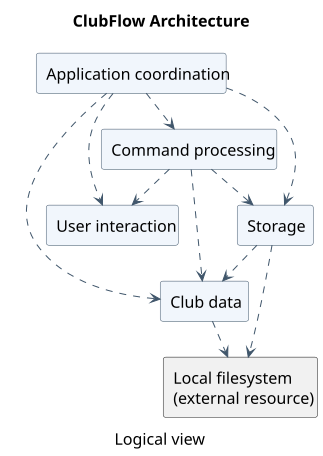</a>
</div>

[PlantUML source](diagrams/architecture/Architecture.puml).

The following are logical responsibilities, not separate modules or a set of
component interfaces. Most core classes are in the `clubflow` package.

| Responsibility | Main classes | Purpose |
| --- | --- | --- |
| Application coordination | `ClubFlow` | Constructs and connects objects, loads startup data, runs the input loop, handles errors, and triggers autosave. |
| User interaction | `UserInterface` | Reads input and prints prompts, results, confirmation messages, and invitations. |
| Command processing | `CommandParser`, `Command`, concrete command classes, search and completion helpers | Resolves keywords and aliases, validates arguments, and executes requests, including event filtering and completion dispatch. |
| Club data | `Club`, `Event`, `Member`, `EventAssignment`, `Photo` | Holds the active club's data and maintains relationships. |
| Storage | `ClubManager`, `SaveLoadManager` | Selects club files, migrates legacy data, serializes records, and synchronizes photos. |

The model is not purely in-memory: `Event` and `Photo` handle photo file operations
directly. Storage separately persists club records and synchronizes saved photo
snapshots.

`ClubFlow` constructs one `UserInterface`, one `CommandParser`, one shared `Club`,
and one `ClubManager`. It creates command objects once and registers them with the
parser. Commands receive the objects they need through their constructors.

At startup, `ClubManager.initialize()` loads the default club. Each input-loop
iteration reads a line with `UserInterface.prompt()`, checks for a suggested
command spelling, and then calls `CommandParser.parse(input)`. A suggested
spelling requires confirmation before parsing; cancellation returns to the
prompt. Commands print their results through the UI and return a boolean
indicating whether the application should exit. After parsing returns normally,
`ClubFlow` saves the active club if it has unsaved changes, then checks the exit
flag.

### UI component

ClubFlow has a **terminal UI**, not a graphical interface. Its concrete UI is
[`UserInterface`](../src/main/java/clubflow/UserInterface.java), which handles
text input and output but does not own or modify club data.

* `ClubFlow` creates one `UserInterface` with the output prefix `[CF] ` and the
  input prompt `> `. It calls `welcome()` once and `prompt()` for each command.
* `UserInterface` reads a complete line using a `Scanner` over `System.in`.
  `ClubFlow` may ask the user to confirm a suggested command spelling before
  passing that line to `CommandParser.parse(...)`.
* Commands and the parser share that UI object. They call `print(message)` for
  results, error explanations, and syntax help. `print(message, indentLevel)`
  adds two spaces per level after `[CF] `; `printWithoutPrefix(text)` is available
  for content that users need to copy without the prefix.
* The welcome banner contains ANSI true-colour escape sequences. Its colours
  depend on terminal support; the prompts and command output remain ordinary text.
* `ClubFlow` handles expected command exceptions and prints their messages.
  `CommandParseException` can also cause the correct command syntax to be shown.
  Unexpected runtime exceptions are logged by `ClubFlow`.

The following class diagram is intentionally limited to UI interaction. It
shows that `UserInterface` is shared rather than recreated for every command.

<div style="overflow-x: auto;">
  <a href="diagrams/architecture/UiClassDiagram.svg">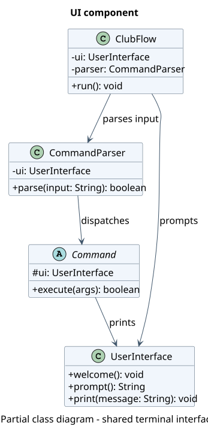</a>
</div>

[PlantUML source](diagrams/architecture/UiClassDiagram.puml).

**Design consideration:** keeping input and printing in one small class makes
terminal formatting consistent. Commands currently print through this class
instead of returning presentation-independent results, however, so replacing
the terminal with a GUI would require changes in command execution or an
adapter. Tests that exercise the real input loop redirect `System.in` and
capture `System.out` for this reason.

### Logic component

Main entry point: [CommandParser.java](../src/main/java/clubflow/command/CommandParser.java).

At startup, `ClubFlow` creates command objects and registers each keyword and
alias with `CommandParser`. An alias points to the same command object as its
full keyword; commands are not rebuilt for each input line. The diagram below
shows a partial class view of command processing.

<div style="overflow-x: auto;">
  <a href="diagrams/architecture/LogicClass.svg">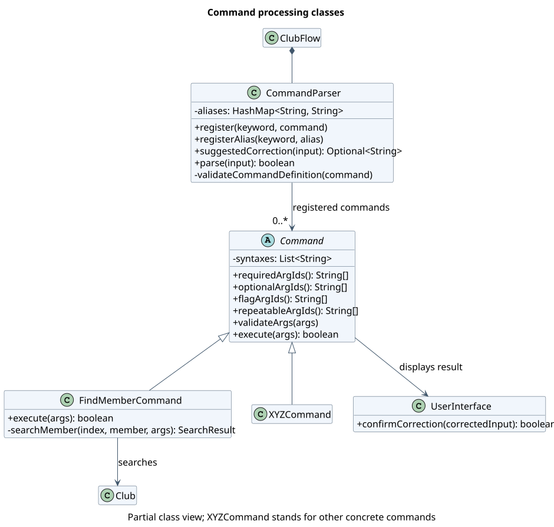</a>
</div>

[PlantUML source](diagrams/architecture/LogicClass.puml). `XYZCommand` represents the many
concrete commands omitted from the diagram. The `+` and `-` markers denote
public and private members respectively; only members relevant to command
processing are shown.

How the Logic component processes input:

1. The input loop calls `suggestedCorrection(input)`. For an unknown command word
   of at least four characters, the parser may offer a uniquely closest full
   keyword within one or two character edits, depending on word length. It
   preserves the arguments. Exact keywords and aliases need no correction.
2. `UserInterface.confirmCorrection(...)` asks the user to press Enter to accept
   the suggestion or `c` to cancel it. A cancelled command is not parsed.
3. `CommandParser.parse(input)` identifies the keyword, preserves text inside
   double quotes while splitting arguments, and checks each argument ID against
   the command's required, optional, flag, and repeatable IDs.
4. The command validates its own rules in `validateArgs(...)` and then runs
   `execute(...)`. The [event creation sequence diagram](#event-management)
   shows this path for one concrete command. A successful execution returns
   `true` only when the application should exit.

An invalid command or argument raises `CommandParseException`. `ClubFlow`
displays the error and, when appropriate, the command syntax.

Each concrete command receives only the collaborators it needs, such as the
shared `Club`, `ClubManager`, or `UserInterface`. The parser knows the `Command`
contract, not each feature's data rules. Adding a command therefore requires
registering it in `ClubFlow` and declaring its arguments in the command class;
the [extension notes](#extending-commands-and-continuous-integration) describe
the checks to make when doing so.

### Model component

The Model component represents and manages the data of the currently active club. Its main classes are `Club`, `Event`, `Member`, `EventAssignment`, and `Photo`.

The following class diagram illustrates the structure of the Model component and the relationships between its classes.

<div style="overflow-x: auto;">
  <a href="diagrams/architecture/ModelClassDiagram.svg">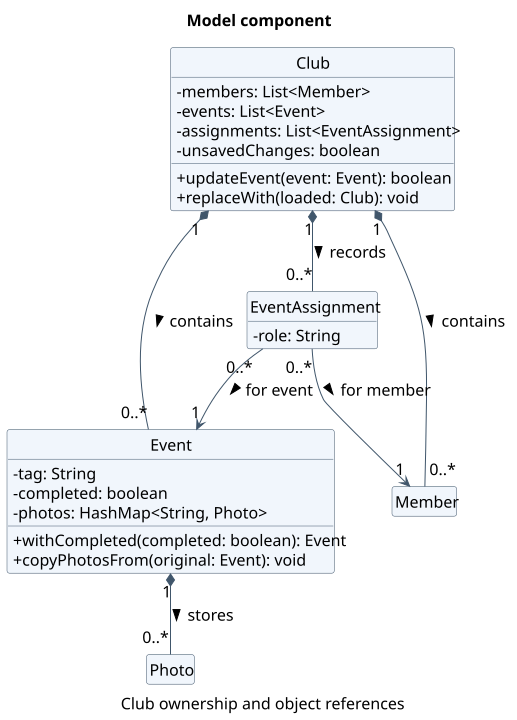</a>
</div>

[PlantUML source](diagrams/architecture/ModelClassDiagram.puml)

The Model component:

- Stores club members, events, and member-event assignments in a shared `Club` object.
- Represents each event using an `Event` object containing event details, completion status, and associated photos.
- Represents each member using a `Member` object containing contact information and club functions.
- Uses `EventAssignment` objects to associate members with events, optionally specifying their responsibilities.
- Uses `Photo` objects to manage images associated with events.
- Maintains consistency between members, events, and assignments when data is modified or deleted.

#### Data management

`Club` maintains separate lists of `Member`, `Event`, and `EventAssignment` objects. These lists are private, and their public getters return read-only snapshots using `List.copyOf()`. This prevents callers from modifying the collections directly.

Events are identified by unique, case-insensitive tags within a club. Members are accessed using one-based indices, corresponding to their positions in the member list.

An `EventAssignment` holds references to a specific `Event` and `Member`, together with an optional role. Using object references rather than member indices ensures that removing another member does not change the meaning of existing assignments.

#### Maintaining data consistency

The Model maintains consistency when existing objects are replaced or removed.

When an event is updated, `Club.updateEvent()` replaces the original `Event` object while preserving its position in the event list. It also transfers the original event's photos and recreates affected `EventAssignment` objects so that they reference the replacement event.

Similarly, `Club.replaceMemberByIndex()` transfers existing assignments to the replacement member. Deleting an event or member removes its associated assignments, preventing references to objects that are no longer part of the club.

#### Shared club instance

Commands operate on a shared `Club` instance rather than maintaining separate copies of club data.

When switching clubs, `ClubManager` loads the selected club and calls `Club.replaceWith()` to replace the shared object's contents. This allows existing command objects to continue using the same `Club` reference without being reconstructed.

#### Tracking unsaved changes

`Club` maintains an `unsavedChanges` flag to indicate whether its data has been modified.

Operations that modify club data set this flag to `true`. After the active club is successfully saved, `ClubManager` calls `markSaved()` to clear the flag.

This allows the application to identify changes requiring persistence without saving after every read-only operation.

### Storage component

### Common classes

There is no separate `commons` package. Shared command infrastructure and helpers
live alongside the commands; expected application failures use `clubflow.exception`.

#### Command contract

[`Command`](../src/main/java/clubflow/command/Command.java) is the shared extension
point for commands. Its argument declarations and syntax strings serve different
consumers: the parser enforces the declarations, while help displays the syntax.
Keep both consistent when changing a command.

Feature commands are grouped under `clubflow.command.event`, `.member`, `.club`,
and `.photo`. The parent `clubflow.command` package keeps the base class, parser,
shared argument IDs, and general commands such as help, exit, load, and completion
dispatch. Command keywords and aliases are unchanged by this package structure.

[`CommandParser`](../src/main/java/clubflow/command/CommandParser.java) handles
input structure, required/allowed arguments, and repetition rules before calling
the command's `validateArgs()`. Keep field values and cross-field rules in the
command or a focused validator, rather than adding feature-specific branches to
the parser. The boolean returned by `execute()` requests application exit; it is
**not** a success or data-changed flag. Autosave instead relies on the shared club's
unsaved flag.

#### Shared event validation

[`EventArgumentIds`](../src/main/java/clubflow/command/EventArgumentIds.java) and
[`EventArgumentValidator`](../src/main/java/clubflow/command/event/EventArgumentValidator.java)
keep creation and editing aligned. The validator checks supplied event fields
before mutation, including rejecting the save format's `|` separator. When a
field rule changes, review both commands and the domain object's invariants.
Search has a different input contract (for example, no required event tag), so its
filter validation stays in `FindEventCommand` rather than reusing this validator.

`EventArgumentIds` stays in the parent package because photo commands also use
these prefixes. The event validator remains package-private within `command.event`.

<div style="overflow-x: auto;">
  <a href="diagrams/common/EventValidationClass.svg">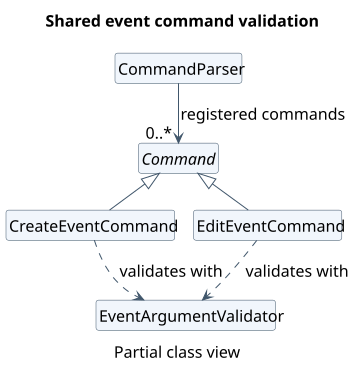</a>
</div>

[PlantUML source](diagrams/common/EventValidationClass.puml).

#### Error handling

* [`ClubFlowException`](../src/main/java/clubflow/exception/ClubFlowException.java)
  is the checked base type for expected application failures and standardizes
  their messages. Propagate these failures to the input loop for display instead
  of printing an error and then throwing it, which would report it twice.
* [`CommandParseException`](../src/main/java/clubflow/exception/CommandParseException.java)
  covers invalid command input. Once a command is selected, the parser attaches
  its keyword so the input loop can also display the correct syntax.
* [`EventNotFoundException`](../src/main/java/clubflow/exception/EventNotFoundException.java)
  and [`DuplicateEventException`](../src/main/java/clubflow/exception/DuplicateEventException.java)
  distinguish failed event lookup from a conflicting tag. These are domain
  failures, not malformed command syntax.

Programming-contract violations, such as invalid command registration, use
unchecked exceptions rather than user-input errors. `ClubFlow` catches and logs
unexpected runtime exceptions at the input-loop boundary.

## Implementation

This section describes noteworthy details of selected implemented features.

### Event management

Use the following entry points when changing event behavior. Command syntax and
user-visible rules belong in the [User Guide](UserGuide.md).

| Feature | Start here |
| --- | --- |
| Create | [CreateEventCommand](../src/main/java/clubflow/command/event/CreateEventCommand.java) |
| Delete | [DeleteEventCommand](../src/main/java/clubflow/command/event/DeleteEventCommand.java) |
| View | [ViewEventCommand](../src/main/java/clubflow/command/event/ViewEventCommand.java) |
| Edit | [EditEventCommand](../src/main/java/clubflow/command/event/EditEventCommand.java) |
| Find | [FindEventCommand](../src/main/java/clubflow/command/event/FindEventCommand.java), [EventSearch](../src/main/java/clubflow/search/EventSearch.java) |
| Completed/pending | [CompletionCommand](../src/main/java/clubflow/command/CompletionCommand.java), [EventCompletion](../src/main/java/clubflow/completion/EventCompletion.java) |

Commands share a long-lived [Club](../src/main/java/clubflow/Club.java). Look up
events on each request: retaining an event reference across requests can leave
a command using an old object after editing, marking, or loading data. Route
mutations through the club so relationship maintenance and autosave stay coordinated.

Deleting an event also removes its member assignments, so deletion changes both
the event list and the assignment roster.

The creation flow below ends before the input loop's autosave step.

<div style="overflow-x: auto;">
  <a href="diagrams/events/CreateEventSequence.svg">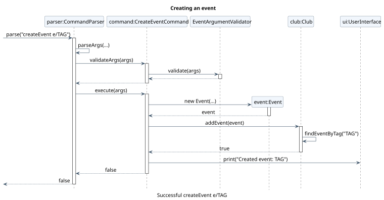</a>
</div>

[PlantUML source](diagrams/events/CreateEventSequence.puml).

#### Editing and replacement

Edits validate a replacement before installing it, avoiding partially applied
changes. The tradeoff is that replacing an event must preserve its position,
photos, and member assignments; this belongs in `Club.updateEvent()`.
When adding an event field, review both editing and completion copy paths,
the displayed/searchable details, and the save/load format together.

<div style="overflow-x: auto;">
  <a href="diagrams/events/EditEventSequence.svg">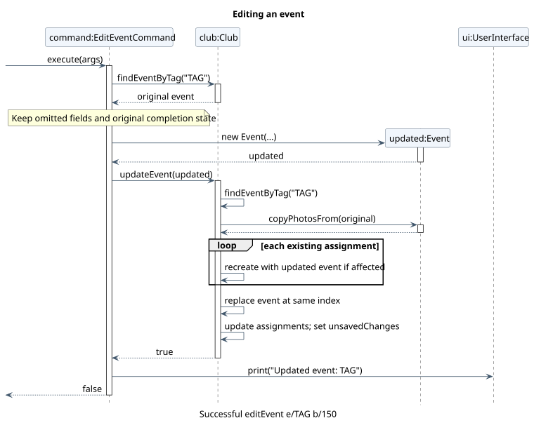</a>
</div>

[PlantUML source](diagrams/events/EditEventSequence.puml).
Autosave follows this flow; the club is marked saved only after persistence succeeds.

An earlier list returned by `getEvents()` still references the previous event;
the club's current list references the replacement instead.

<div style="overflow-x: auto;">
  <a href="diagrams/events/EventReplacementObject.svg">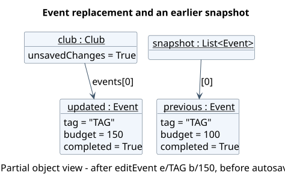</a>
</div>

[PlantUML source](diagrams/events/EventReplacementObject.puml).

#### Search

Search combines predicates over the current event snapshot. A linear scan keeps
ordering predictable and avoids maintaining indexes as events change. Keep
filter validation in `FindEventCommand` and matching in `EventSearch`; compile
filter values once per request. Consider indexing only if measured usage justifies
the additional update logic.

<div style="overflow-x: auto;">
  <a href="diagrams/events/EventSearchClass.svg">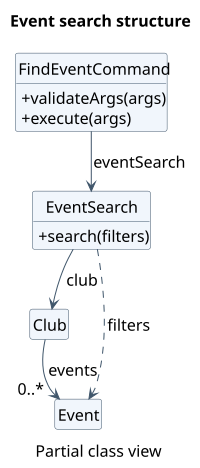</a>
</div>

[PlantUML source](diagrams/events/EventSearchClass.puml).

<div style="overflow-x: auto;">
  <a href="diagrams/events/FindEventSequence.svg">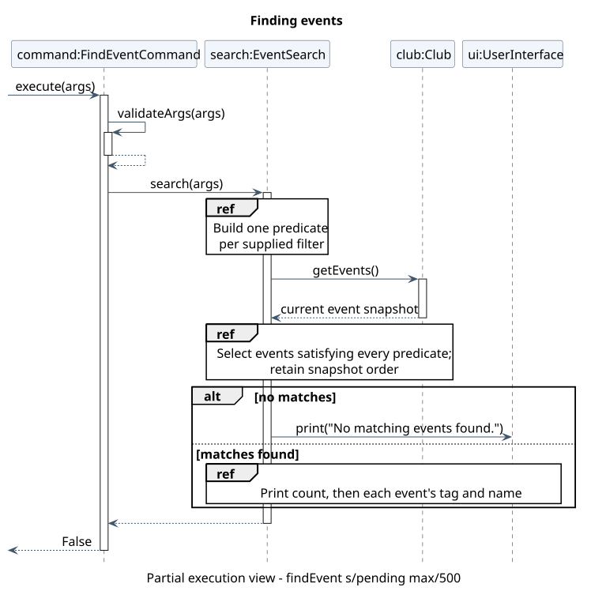</a>
</div>

[PlantUML source](diagrams/events/FindEventSequence.puml).

#### Completion

Mark and unmark share dispatch logic, with the desired state configured at
registration. The event handler owns lookup and replacement, keeping the command
independent of event details. Preserve idempotency: repeating a request must keep
the requested state, not toggle it. Completion uses the same replacement path as
editing, so both features must preserve unrelated data.

Both commands share a method-reference handler bound to the same `EventCompletion`
object, as shown below.

<div style="overflow-x: auto;">
  <a href="diagrams/events/CompletionWiringObject.svg">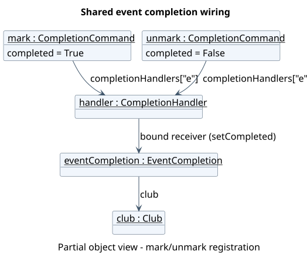</a>
</div>

[PlantUML source](diagrams/events/CompletionWiringObject.puml).

In the sequence diagram, `completed` is `True` for `mark` and `False` for `unmark`.

<div style="overflow-x: auto;">
  <a href="diagrams/events/CompletionSequence.svg">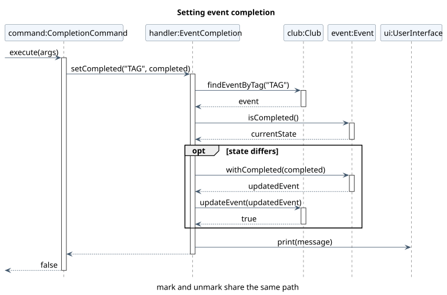</a>
</div>

[PlantUML source](diagrams/events/CompletionSequence.puml).

#### Event invitations

`InviteCommand` implements `invite e/TAG`. It looks up the event in the active
club and formats its name, date, and venue as a copyable text invitation.
Missing optional details become visible placeholders so the organiser can
complete the message before sharing it. `UserInterface.printWithoutPrefix(...)`
prints the invitation block without the usual `[CF]` prefix on every line.
This command only reads event data; an unknown tag raises
`EventNotFoundException` and produces no invitation. The invitation is for an
event and contains text only; it does not attach event photos or send messages.

### Searching members

`FindMemberCommand` searches the current `Club.getMembers()` snapshot on every
request. It does not retain a result list, so a later edit, deletion, or club
switch is reflected in the next search. Results carry the member's **current
one-based index**, which can then be used by `editMember`, `assignMember`, or
`deleteMember`. A deletion can change later indices; clients must obtain a fresh
index before acting again.

The parser accepts repeated `q/` and `f/` arguments. `Command.getArgumentValues(...)`
recovers their separate values, and `searchMember(...)` requires **every** supplied
filter to match. For `q/`, the command takes the best match across name, Telegram,
email, and functions; `n/`, `t/`, `e/`, and `f/` restrict matching to their named
fields. Matching ignores case and surrounding whitespace. The command also
accepts a leading `@` in Telegram searches.

Direct matches receive scores of 300 for exact, 200 for prefix, and 100 for
substring matches. Scores from multiple filters are added; ties keep member-list
order through the stored index. If a name or Telegram handle has no direct match,
a four- or five-character query may have one spelling edit, while a query of six
to 64 characters may have two. The bounded edit-distance calculation compares
whole names and individual name words; email and functions remain strict.
Members requiring any spelling tolerance appear under **Possible matches**,
separate from direct results, with at most five suggestions shown.

This design favors understandable, current results over a search index that would
have to be maintained after every edit and club switch. Possible matches are
never selected automatically: the user checks the displayed contact details and
index before issuing a command that changes data.

### Switching clubs without rebuilding commands

ClubFlow supports multiple clubs, while keeping the same parser, command
objects, and in-memory [`Club`](../src/main/java/clubflow/Club.java) instance.
This is important because event and member commands receive their `Club` in
their constructors at startup. Replacing the `Club` *reference* on a switch
would leave those commands pointing at the previous club's data.

The relevant classes are
[`ClubManager`](../src/main/java/clubflow/ClubManager.java),
[`CreateClubCommand`](../src/main/java/clubflow/command/club/CreateClubCommand.java),
[`SwitchClubCommand`](../src/main/java/clubflow/command/club/SwitchClubCommand.java),
[`ListClubsCommand`](../src/main/java/clubflow/command/club/ListClubsCommand.java), and
[`CurrentClubCommand`](../src/main/java/clubflow/command/club/CurrentClubCommand.java).

**Club creation and selection:**

1. A club ID is validated as letters, digits, `_` or `-` and normalised to
   lowercase using `Locale.ROOT`. `default` is reserved. Club IDs are used
   as directory names, so separators and parent-directory traversal are rejected.
2. `createClub` creates an initially empty `club.cf` file in
   `saves/clubs/<club-id>/`. It does **not** change the active club.
3. `listClubs` lists club directories containing a `club.cf` file; the default
   club is first, followed by other IDs in case-insensitive sorted order.
   `currentClub` reads the active ID from `ClubManager`.
4. The application starts in `default` on every launch. The last selected
   non-default club is **not** restored as the active club at the next launch.

**Switching:** `SwitchClubCommand.execute(...)` delegates to
`ClubManager.switchClub(targetId)`. The manager checks that the target file
exists and, unless it is already active, calls `saveActiveClub()` before
loading the target data with `SaveLoadManager.load(...)` into a temporary
`Club`. Only after the load succeeds does it call
`activeClub.replaceWith(loaded)` and change `activeClubId`. `replaceWith`
replaces the shared object's member, event, and assignment collections instead
of replacing the shared object itself. The unsaved flag is then cleared.
`SaveLoadManager` also saves the current club's photos to its own directory and
loads the target club's photos into the working cache.

<div style="overflow-x: auto;">
  <a href="diagrams/clubs/SwitchClubSequence.svg">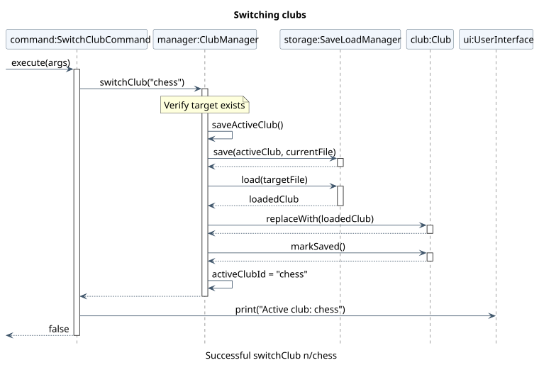</a>
</div>

[PlantUML source](diagrams/clubs/SwitchClubSequence.puml).

**Failure handling:** an unknown club raises `ClubNotFoundException`. Failure
to save or load displays an I/O error; the active ID is not changed. A
malformed target save file is rejected before the in-memory club is replaced.
A request to switch to the already active club is a no-op. A successful
switch does not invoke the input loop's normal dirty-data autosave because
the loaded club is marked saved.

**Design alternatives:** rebuilding all commands on every switch would avoid
shared mutable state, but requires rebuilding registrations and ensuring no
command retains stale dependencies. Using one shared `Club` with
`replaceWith(...)` keeps registrations stable and preserves existing
command constructors. The tradeoff is that commands and other collaborators
must not cache references to individual `Event` or `Member` instances across
switches. It also means only one club is loaded into the shared model at a
time.

### Autosave, import, and file format

### Photo lifecycle and persistence limits

ClubFlow supports importing, listing, opening, and deleting photos associated with events. The following entry points are useful when modifying photo management behaviour. Command syntax and user-visible rules are documented in the [User Guide](UserGuide.md).

| Feature           | Start here                                                                                               |
|-------------------|----------------------------------------------------------------------------------------------------------|
| Import photo      | [AddPhotoCommand](../src/main/java/clubflow/command/photo/AddPhotoCommand.java)                                |
| Import directory  | [AddAllPhotoCommand](../src/main/java/clubflow/command/photo/AddAllPhotoCommand.java)                          |
| List photos       | [ListPhotoCommand](../src/main/java/clubflow/command/photo/ListPhotoCommand.java)                              |
| Open photo        | [OpenPhotoCommand](../src/main/java/clubflow/command/photo/OpenPhotoCommand.java)                              |
| Delete photos     | [DeletePhotoCommand](../src/main/java/clubflow/command/photo/DeletePhotoCommand.java)                          |
| Photo operations  | [Photo](../src/main/java/clubflow/photo/Photo.java), [Event](../src/main/java/clubflow/event/Event.java) |
| Photo persistence | [SaveLoadManager](../src/main/java/clubflow/SaveLoadManager.java)                                        |

Photo commands operate through the shared `Club` object, which delegates photo operations to the corresponding `Event`. The `Photo` class handles image file operations, while `SaveLoadManager` synchronizes photos between the working cache and club-specific save directories.

#### Photo importing

Photos are imported into the working directory under `cache/photos/<event-tag>/`. Each `Event` maintains a `HashMap<String, Photo>` mapping photo names to their corresponding `Photo` objects.

The following sequence diagram illustrates the process of importing a single photo.

<div style="overflow-x: auto;">
  <a href="diagrams/photos/PhotoImportSequence.svg">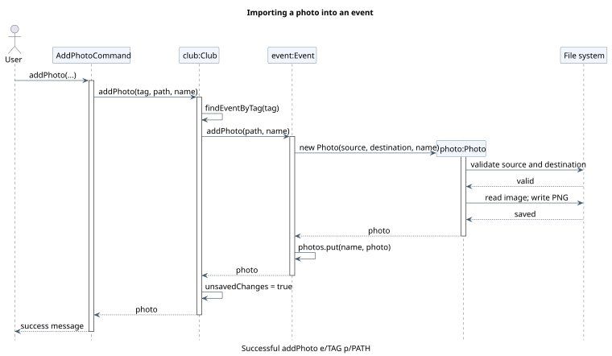</a>
</div>

[PlantUML source](diagrams/photos/PhotoImportSequence.puml)

The import process works as follows:

1. `AddPhotoCommand` validates the command arguments and calls `Club.addPhoto()`.
2. `Club` locates the event using its tag and calls `Event.addPhoto()`.
3. `Event` creates a `Photo` object, which validates the photo name and source file.
4. The `Photo` constructor reads the image, converts it to PNG format, and saves it in the event's photo directory.
5. `Event` registers the photo in its collection, and `Club` marks its data as unsaved.

If no photo name is specified, the source filename without its extension is used.

Bulk importing follows a similar process through `AddAllPhotoCommand` and `Event.addPhotos()`. Each regular file in the specified directory is processed individually. Failed imports are logged and counted without preventing the remaining files from being processed.

#### Photo management

The following operations are supported:

| Operation | Implementation |
| --- | --- |
| List | `ListPhotoCommand` retrieves photo names from `Event.getPhotoNames()`. |
| Open | `OpenPhotoCommand` uses `Event.openPhoto()` or `Event.openPhotoDir()` to open an image or its directory through the operating system. |
| Delete | `Event.deletePhoto()` deletes the physical image before removing its registration from the event. |
| Delete all | `Event.deleteAllPhotos()` attempts to delete every registered photo, recording successful and failed deletions. |

Photos are registered by name within each event. Importing another photo with an existing destination filename is rejected to prevent overwriting.

#### Photo persistence

`SaveLoadManager` stores photos separately from the club's text-based data file.

When saving, `savePhotos()` copies the active club's photo directories from the working cache to the selected club's save directory. When loading, `loadPhotos()` restores the saved directories into the cache and reconstructs the `Photo` objects from the available PNG files.

The directory replacement uses a temporary staging directory and a backup of the previous destination, allowing the previous photo directory to be restored if installation of the staged directory fails.

This design keeps image files separate from structured club records and allows photos to remain associated with their events across application restarts and club switches.

#### Error handling and limitations

Invalid photo names, missing source files, unsupported images, duplicate filenames, and file-operation failures are reported through photo-specific exceptions.

Photo operations also have several limitations:

- Photos are converted to PNG, regardless of their original format.
- Opening photos depends on the operating system's desktop support.
- Bulk imports can partially succeed when some files are invalid.
- Club data and photo files are saved separately. Therefore, a failure during photo synchronization can leave the text save file updated while photo persistence remains incomplete.
- Removing an event deletes its model entry and assignments, but does not immediately delete its photo directory. Obsolete photo directories are excluded when the next successful photo-directory synchronization replaces the saved photo collection.

## Documentation, logging, testing, dev-ops

### Documentation

The [User Guide](UserGuide.md) is where command syntax, examples, and
user-visible behavior belong. This Developer Guide explains responsibilities, data
flows, design choices, and a short manual test path. The repository
[README](../README.md) includes Gradle and IDE setup notes, although its
starter application example still needs updating. When changing a command,
update its UG entry and this guide's affected diagrams or test steps in the
same change so that the published instructions describe the code.

The SVG diagrams embedded here are generated from the `.puml` sources in
[`docs/diagrams`](diagrams/), grouped by architecture, common classes, and feature.
Each source stays beside its SVG; shared settings are in
[`UmlStyle.iuml`](diagrams/shared/UmlStyle.iuml). See the
[diagram maintenance notes](diagrams/README.md) for regeneration instructions, and
prefer a small diagram focused on one question over listing every command class.

### Logging

[`ClubFlow.configureLogging()`](../src/main/java/clubflow/ClubFlow.java) configures
Java's `java.util.logging` package for the `clubflow` logger hierarchy. Records
are appended to `clubflow.log` in the working directory using `SimpleFormatter`.
Parent console handlers are disabled so diagnostics do not interrupt command output.

* `INFO`: application lifecycle and save/load activity.
* `FINE`: command registration, execution, data changes, and expected command failures.
* `WARNING`: file loading/saving and photo I/O failures.
* `SEVERE`: unexpected runtime failures in the input loop.

New classes should use `Logger.getLogger(MyClass.class.getName())` and inherit
the package handler rather than install their own handlers. `FINE` diagnostics
require the logger and handler levels to allow `FINE`; recording a message at
that level does not itself enable it.

If the log file cannot be opened, package logging is disabled without preventing
startup. Log files are ignored by Git.

### Automated testing and style checks

ClubFlow uses JUnit 5 with the Gradle `test` task. Test source files live in
[`src/test/java/clubflow/`](../src/test/java/clubflow) and its `command`
subdirectory. `build.gradle` enables assertions when running tests, so internal
invariants are checked as well as externally visible results.

Testing is performed at different levels:

* **Command and parser tests:**
  [`ClubCommandsTest`](../src/test/java/clubflow/command/ClubCommandsTest.java)
  checks club command syntax, duplicate and invalid IDs, active-club output,
  and failure paths. Other command tests exercise events and members.
* **Storage/model tests:**
  [`ClubManagerTest`](../src/test/java/clubflow/ClubManagerTest.java)
  checks club creation, name normalisation, switching, save files, and legacy
  migration. [`MultiClubPhotoStorageTest`](../src/test/java/clubflow/MultiClubPhotoStorageTest.java)
  checks per-club photo snapshots.
* **End-to-end input-loop tests:**
  [`ClubFlowMultiClubTest`](../src/test/java/clubflow/ClubFlowMultiClubTest.java)
  submits lines to a fresh `ClubFlow`, captures terminal output, and starts
  another instance using the same test directory to check restart persistence
  and separation between clubs. The test supplies an alternate save path so it
  does not overwrite a user's real `saves/` directory.

JUnit's `@TempDir` provides disposable save-file locations in tests that
access the filesystem. UI integration tests temporarily replace `System.in`
and `System.out` and restore them after each test. This prevents tests from
requiring manual input and allows success and error messages to be asserted.

From the project root, run the whole suite and then the project's Checkstyle
rules (on macOS/Linux, use `./gradlew` in place of `.\gradlew.bat`):

```powershell
.\gradlew.bat test
.\gradlew.bat check
```

To run only the multiple-club regression tests:

```powershell
.\gradlew.bat test --tests clubflow.ClubManagerTest --tests clubflow.ClubFlowMultiClubTest --tests clubflow.command.ClubCommandsTest
```

Automated tests reduce regressions, but do not establish complete path or line
coverage by themselves. Manual tests are still needed for a real terminal,
photo viewers, permissions errors, and full release packaging. See
[Appendix E](#appendix-e-instructions-for-manual-testing).

### Extending commands and continuous integration

ClubFlow uses an extensible command system consisting of the abstract `Command` class and `CommandParser`. New commands can be added without modifying the parser's core parsing logic.

#### Adding a new command

To implement a new command:

1. Create a class extending `Command` and pass the shared `UserInterface` to its superclass constructor.
2. Override `requiredArgIds()` and `optionalArgIds()` to declare accepted arguments.
3. Override `execute()` to implement the command's behaviour.
4. Override `validateArgs()` if additional command-specific validation is required.
5. Register the command in `ClubFlow` using `CommandParser.register()`.

Commands may also override `flagArgIds()` for standalone flags and `repeatableArgIds()` for arguments that can appear multiple times.

The parser validates argument identifiers, required arguments, duplicate arguments, and command-specific rules before execution.

#### Defining command syntax

Each command registers its supported syntax using `addSyntax()` in its constructor.

For example, `AddPhotoCommand` declares:

```java
addSyntax("e/Tag [n/Name] p/Path");
```

Multiple calls to `addSyntax()` can describe alternative forms of the same command. These descriptions are retrieved through `getSyntaxes()` and displayed by the help system.

#### Registering aliases

`CommandParser.registerAlias()` associates an alternative keyword with an existing command.

For example:

```java
parser.register("addPhoto", new AddPhotoCommand(ui, club));
parser.registerAlias("addPhoto", "ap");
```

Both `addphoto` and `ap` execute the same command object.

The parser maintains mappings between aliases and their original keywords, allowing `HelpCommand` to display aliases alongside command syntax.

Command keywords and aliases are case-insensitive. Duplicate registered keywords are rejected.

#### Testing new commands

Developers should test successful execution, missing required arguments, invalid identifiers, duplicate arguments, and command-specific validation.

When adding a new command, update its help syntax, relevant automated tests, and the User Guide to keep documentation consistent with the implementation.

## Appendix A: Product Scope

### Target user profile

Student club organisers and committee members who:

- Need to manage club events, members, and event responsibilities.
- Organise multiple events or manage multiple clubs.
- Prefer a keyboard-driven application over a graphical interface.
- Are comfortable using command-line applications.
- Need to store and retrieve club information across sessions.

### Value proposition

ClubFlow gives organisers of student clubs a single, lightweight command-line
workspace for the information needed to run their activities:

* **Centralised event planning:** event dates, deadlines, budgets, venues,
  logistics, and completion state are recorded alongside member assignments.
* **Less repetitive administration:** organisers can look up events or members,
  update details through commands, and have changes saved without running a
  separate save command.
* **Separate clubs on one installation:** organisers helping more than one club
  can create and switch between independent club records. Reusing the same
  event tag in different clubs does not cause a conflict.
* **Event photo organisation:** photos are associated with events and saved
  with the owning club's data for later use.

The product is intended for local, offline record-keeping. It does not provide
shared live editing, cloud synchronisation, or automatic event notifications;
organisers coordinating across devices must transfer their files themselves.

## Appendix B: User Stories

These MVP stories are based on the team's brainstorming list. Overlapping ideas
about editing events and saving data have been combined. The stories below
describe features available in the current implementation.

Priorities: High (must have) - `* * *`, Medium (nice to have) - `* *`, Low
(unlikely to have) - `*`.

| Priority | As a ... | I want to ... | So that I can ... |
| --- | --- | --- | --- |
| `* * *` | interest group head | create an event with its name, date, venue, deadline, budget, and logistics | give the team a shared plan for its work |
| `* * *` | club organiser | view all events or one event's details and budget | check plans before changing them |
| `* * *` | event organiser | edit an event's date, deadline, budget, venue, logistics, or name | keep its record accurate when plans change |
| `* * *` | club organiser | delete an outdated event | remove plans that are no longer relevant |
| `* * *` | club manager | add and view members with their contact details and functions | keep an up-to-date membership record |
| `* * *` | club manager | edit a member's details | keep contact information and functions accurate |
| `* * *` | club manager | delete a former member | keep the roster current |
| `* * *` | event organiser | assign or unassign members and record their event roles | see who is responsible for an event |
| `* * *` | regular user | have club data load and save automatically | resume work after restarting without saving each change manually |
| `* * *` | first-time user | see available commands and the syntax of a chosen command in the help menu | use ClubFlow without opening the User Guide |
| `* *` | regular user | search events by keyword or other event details | locate an event without reading the whole list |
| `* *` | regular user | search members by name, contact, or function | locate the intended member without inspecting the whole roster |
| `* *` | club manager | mark events as completed and find completed events later | refer to past plans when organising new events |
| `* *` | manager of several clubs | create, list, and switch between separate club records | manage each club's information in one application |
| `* *` | event organiser | add, view, and remove event photos stored locally | keep visual records with their events |
| `* *` | regular user | use short command aliases | enter frequent commands more quickly |
| `* *` | regular user | confirm a suggested correction for a misspelled command | recover from a typo without re-entering its arguments |
| `* *` | event organiser | generate a copyable invitation using an event's saved details | share its name, date, and venue without retyping them |
| `* *` | regular user | see clear prompts and visually distinct command results | read the command-line interface more easily |

### Use cases

For all use cases below, the system is `ClubFlow` and the actor is the club
organiser, unless specified otherwise.

#### UC1: Create an event

**MSS**

1. The organiser requests to create an event with a tag and any desired details.
2. ClubFlow validates the details and checks that the tag is unique in the active club.
3. ClubFlow adds the event, displays its tag, and attempts to autosave the club.

Use case ends.

**Extensions**

* 2a. The tag is missing, a detail is invalid, or the tag already exists.
  * 2a1. ClubFlow shows an error and leaves the event list unchanged.

  Use case ends.
* 3a. Autosave fails.
  * 3a1. ClubFlow warns the organiser; the new event remains in memory for a
    later save attempt.

  Use case ends.

#### UC2: Edit an event

**MSS**

1. The organiser requests to view an event using its tag.
2. ClubFlow shows the event's details.
3. The organiser requests to edit that event with at least one changed detail.
4. ClubFlow validates and applies the changes while retaining the event's
   position, completion state, photos, and member assignments.
5. ClubFlow confirms the event tag and attempts autosave.

Use case ends.

**Extensions**

* 1a. The event tag is unknown.
  * 1a1. ClubFlow shows an error.

  Use case ends.
* 4a. A changed detail is invalid.
  * 4a1. ClubFlow shows an error without applying the edit.

  Use case ends.
* 5a. Autosave fails.
  * 5a1. ClubFlow warns the organiser; the edited event remains in memory.

  Use case ends.

#### UC3: Delete an event

**MSS**

1. The organiser requests to delete an event using its tag.
2. ClubFlow removes the event and its member assignments.
3. ClubFlow displays a confirmation and attempts autosave.

Use case ends.

**Extensions**

* 1a. The event tag is unknown.
  * 1a1. ClubFlow shows an error; no event or assignment is removed.

  Use case ends.
* 3a. Autosave fails.
  * 3a1. ClubFlow warns the organiser; the deletion remains in memory for a
    later save attempt.

  Use case ends.

#### UC4: Assign a member to an event

**MSS (main success scenario)**

1. The organiser has an event and a member in the active club.
2. The organiser uses `viewMember` to find the member's current one-based index.
3. The organiser enters `assignMember e/TAG i/INDEX` with an optional `r/ROLE`.
4. ClubFlow verifies that the event and member exist and that the assignment
   does not already exist.
5. ClubFlow creates the assignment, displays a confirmation, and attempts to
   autosave the active club.
6. The organiser can use `viewEvent e/TAG` to inspect the assigned member and role.

**Extensions:** an unknown event or member is reported without making an
assignment. An already-assigned member is not assigned twice. An invalid index
or role is rejected. If autosave fails, ClubFlow warns the organiser and keeps
the change in memory for another save attempt.

#### UC5: Switch clubs

**MSS (main success scenario)**

1. The organiser has created a second club using `createClub n/ID`.
2. The organiser runs `listClubs` to check the available clubs.
3. The organiser enters `switchClub n/ID` for a club other than the active one.
4. ClubFlow saves the current club and loads the selected club's records.
5. ClubFlow updates the shared in-memory data and makes the selected club active.
6. ClubFlow displays `Active club: id`. The organiser can verify the choice
   using `currentClub` and view the new club's events and members.

**Extensions:** an invalid ID is rejected by the parser; an unknown ID is
reported without switching. If saving the current club or loading the target
fails, the active club does not change. Switching to the already active club
simply reports that club. On restart, ClubFlow loads `default`, not the club
that was last active.

#### UC6: Set an event's completion state

**MSS**

1. The organiser requests to mark an existing event as completed.
2. ClubFlow locates the event using its tag.
3. ClubFlow updates the event's completion state.
4. ClubFlow confirms the operation and attempts to save the changes.

Use case ends.

**Extensions**

- 1a. The organiser requests to mark the event as not completed.
    - 1a1. ClubFlow applies the pending state instead.
    - Use case resumes at step 2.

- 2a. The specified event does not exist.
    - 2a1. ClubFlow displays an error message.
    - Use case ends.

- 3a. The event is already in the requested completion state.
    - 3a1. ClubFlow retains the existing state.
    - Use case resumes at step 4.

- 4a. The changes cannot be saved.
    - 4a1. ClubFlow displays a warning.
    - 4a2. The updated state remains in memory.
    - Use case ends.

#### UC7: Import photos into an event

**MSS**

1. The organiser requests to import a photo into an existing event.
2. ClubFlow verifies that the specified event exists.
3. ClubFlow validates the photo name and source image.
4. ClubFlow converts the image to PNG format and saves it in the event's photo directory.
5. ClubFlow associates the photo with the event and confirms the successful import.

Use case ends.

**Extensions**

- 2a. The specified event does not exist.
    - 2a1. ClubFlow displays an error message.
    - Use case ends.

- 3a. The photo name is invalid or already exists.
    - 3a1. ClubFlow displays an error message.
    - Use case ends.

- 3b. The source image is missing or unsupported.
    - 3b1. ClubFlow displays an error message.
    - Use case ends.

- 4a. The image cannot be saved due to a file-system error.
    - 4a1. ClubFlow displays an error message.
    - Use case ends.

## Appendix C: Non-Functional Requirements

The following requirements describe the intended v2.1 release. They are stated
in terms that a tester or maintainer can check:

1. **Operating environment:** ClubFlow must run from a terminal with JDK 25,
   without requiring a GUI framework, a database server, or an internet
   connection. The release JAR must launch using the documented command.
2. **Input and error handling:** an invalid command or an unknown club must
   produce a readable explanation without terminating an otherwise usable
   command session. Recoverable I/O failures must be reported to the user.
3. **Club isolation:** events, members, assignments, and photos belonging to
   one club must not appear when a different club is selected. The same event
   tag may be used independently in two clubs.
4. **Persistent local data:** club records must be stored in distinct local
   club directories and must remain available after closing and restarting
   the application, provided the save succeeded. On startup the app must
   select `default`.
5. **Data integrity:** rejecting an invalid target save file must not replace
   the currently loaded member, event, or assignment records. Duplicate club
   IDs differing only in case must not create a second club.
6. **Maintainability:** Java source and test code must follow the repository's
   Checkstyle rules, and the documented regression commands must be runnable
   through Gradle with JUnit 5.
7. **Portability of saved data:** club records and associated photos must be
   transferable by copying the appropriate club directory while ClubFlow is
   not running. The user guide must identify the required paths.

## Appendix D: Glossary

| Term             | Meaning                                                                                             |
|------------------|-----------------------------------------------------------------------------------------------------|
| Active club      | The club whose data is currently being managed by ClubFlow.                                         |
| Event tag        | A unique, case-insensitive identifier for an event within a club.                                   |
| Event assignment | An association between a member and an event, optionally specifying the member's responsibility.    |
| Completion state | Indicates whether an event is completed or pending.                                                 |
| Photo cache      | The working directory (`cache/photos/`) containing photos associated with the active club's events. |
| Autosave         | The automatic saving of modified club data without requiring an explicit save command.              |
| Unsaved flag     | An indicator that the active club contains changes that have not yet been saved.                    |
| Club data file   | A file containing the saved members, events, and assignments of a club.                             |
| Command alias    | An alternative keyword that invokes an existing command.                                            |

## Appendix E: Instructions for Manual Testing

Use Java 25 and a **new, empty working directory**. Launch the packaged application
with `java -ea -cp "<absolute-path-to-clubflow.jar>" clubflow.ClubFlow`, replacing
the placeholder with the actual JAR path. This uses the tested folder for saves,
photos, and logs. The cases below are a starting point for exploratory testing.

### Launch, help, and shutdown

The following tests verify application startup, command help, error handling, and normal termination.

#### Initial launch

**Prerequisites:** Launch ClubFlow from a new, empty working directory using the instructions in [Setting up, getting started](#setting-up-getting-started).

**Expected:** ClubFlow displays its welcome banner, the message `Welcome to ClubFlow!`, and instructions to type `help`. The application then displays the `>` prompt.

#### Viewing command help

**Test case:** `help`

**Expected:** ClubFlow displays all registered commands, their supported syntaxes, and available aliases.

**Test case:** `help c/addphoto`

**Expected:** ClubFlow displays the syntax for `addphoto` and its alias `ap`.

**Test case:** `help c/ap`

**Expected:** ClubFlow displays the same command syntax and alias information as `help c/addphoto`.

**Test case:** `help c/unknown`

**Expected:** ClubFlow displays an error indicating that the command does not exist.

#### Invalid commands

**Test case:** `unknowncommand`

**Expected:** ClubFlow reports that the command does not exist and suggests using `help`.

**Test case:** Submit an empty input.

**Expected:** ClubFlow reports that the command must not be blank and continues accepting input.

#### Normal shutdown

**Test case:** `exit`

**Expected:** ClubFlow displays `Goodbye!` and terminates normally.

**Test case:** Restart ClubFlow after creating an event and exiting.

**Expected:** Previously saved club data is loaded, and the event remains available.

### Event workflow

Start with an empty default club. Run these steps in order: the member workflow
below uses the `CAMP` event left by this one. The User Guide gives additional
command examples; automated tests cover input boundaries.

1. Creating and viewing events

   1. Prerequisites: The active default club has no events.
   2. Test case: Enter `createEvent e/CAMP n/"Welcome Camp" d/2026-12-25 b/100 v/"Main Hall"`,
      `createEvent e/TEMP`, then `viewEvent all`.
   3. Expected: Both events appear in creation order with `Not completed` status.

2. Generating an invitation

   1. Test case: Enter `invite e/CAMP`.
   2. Expected: A copyable text invitation names `Welcome Camp` and contains
      `Date: 2026-12-25` and `Location: Main Hall`.
   3. Test case: Enter `invite e/UNKNOWN`.
   4. Expected: ClubFlow reports that the event is not found and prints no invitation.

3. Correcting a command keyword

   1. Test case: Enter `invte e/CAMP`, then press Enter at the confirmation prompt.
   2. Expected: ClubFlow suggests `invite e/CAMP` and prints the invitation.
   3. Test case: Enter `invte e/CAMP` again, then enter `c` at the prompt.
   4. Expected: ClubFlow prints `Command cancelled.` and does not print an
      invitation for the cancelled command.

4. Editing, completing, and finding an event

   1. Test case: Enter `mark e/CAMP` twice and `editEvent e/camp b/150`, then
      `viewEvent e/CAMP` and `viewEvent all`.
   2. Expected: `CAMP` has a `$150.00` budget and `Completed` status. It still
      appears before `TEMP`.
   3. Test case: Enter `findEvent s/completed min/150 max/150`, then
      `findEvent q/Welcome`.
   4. Expected: Both searches find `CAMP`.

5. Rejecting invalid event changes

   1. Test case: Enter `editEvent e/CAMP n/Changed b/-1` and `createEvent e/camp`,
      then `viewEvent e/CAMP`.
   2. Expected: Both changes produce errors. `CAMP` retains its `Welcome Camp`
      name and `$150.00` budget; no duplicate is created.

6. Checking restart persistence and deletion

   1. Test case: Enter `exit`, restart from the same working directory, then
      `viewEvent e/CAMP`.
   2. Expected: The edited budget and completion state persist.
   3. Test case: Enter `unmark e/CAMP` twice and `deleteEvent e/temp`, then
      `exit`, restart, and enter `viewEvent all`.
   4. Expected: `CAMP` is `Not completed` and `TEMP` is absent.

### Members, assignments, and deletion

Continue in the same working directory after the event workflow. Search results
report current member indices; obtain a fresh index after deleting a member.

1. Creating and finding members

   1. Prerequisites: `CAMP` exists and the active club has no members.
   2. Test case: Enter `createMember n/"Alice Tan" t/alice f/Logistics`,
      `createMember n/"Bob Lim" e/bob@example.com f/Finance`, then `viewMember`.
   3. Expected: Alice is index 1 and Bob is index 2, with their respective
      contact and function details.
   4. Test case: Enter `findMember q/alce`, `findMember f/Finance`, then
      `findMember n/"Alice Tan" f/Logistics`.
   5. Expected: Alice appears under `Possible matches` for `q/alce`; Bob is a
      direct match at index 2 for `f/Finance`; both filters match Alice directly
      in the final search.

2. Assigning and editing a member

   1. Test case: Enter `assignMember e/CAMP i/1 r/"Lead Host"`, then
      `viewEvent e/CAMP`.
   2. Expected: Alice appears in the assigned members section with that role.
   3. Test case: Enter `editMember i/1 n/"Alicia Tan"`, then `viewEvent e/CAMP`
      and `viewMember`.
   4. Expected: The same assignment shows Alicia, still at member index 1.

3. Unassigning and deleting a member

   1. Test case: Enter `unassignMember e/CAMP i/1`, then `viewEvent e/CAMP`.
   2. Expected: Alicia is no longer assigned. Enter `assignMember e/CAMP i/1`
      to set up the deletion check.
   3. Test case: Enter `deleteMember i/2`, then enter `n` at its confirmation
      prompt. Run `viewMember`.
   4. Expected: Both members remain.
   5. Test case: Enter `deleteMember i/1 /f`, then `viewMember` and
      `viewEvent e/CAMP`. Restart from the same working directory and check again.
   6. Expected: Only Bob remains, now at index 1. The deleted member no longer
      appears in the event assignment. Both changes persist after restart.

### Multiple clubs and restart persistence

Perform this sequence in a **fresh, empty working directory** so existing
club data is not affected. Commands use exact formats from the User Guide.

1. Enter `currentClub`, then `listClubs`. Expect `Active club: default`
   and `default (active)` in the list.
2. Enter `createEvent e/AGM n/DefaultMeeting` and
   `createMember n/Alice t/alice`. These belong to `default`.
3. Enter `createClub n/chess` and then `listClubs`. Expect `chess` to appear,
   but `default` to remain active.
4. Enter `createClub n/CHESS`. Expect a duplicate-club error. Then enter
   `switchClub n/chess` and `currentClub`. Expect `Active club: chess`.
5. Enter `viewEvent all` and `viewMember`. Expect `No events found.` and
   `No members found.`; the default club's records must not appear.
6. Enter `createEvent e/AGM n/ChessMeeting` and
   `createMember n/Bob t/bob`. The same event tag is allowed in this club.
7. Enter `switchClub n/default`, `viewEvent e/AGM`, and `viewMember`.
   Expect `DefaultMeeting` and `Alice`, but not `ChessMeeting` or `Bob`.
8. Enter `switchClub n/chess`, `viewEvent e/AGM`, and `viewMember`.
   Expect `ChessMeeting` and `Bob`, but not the default club's records.
9. Enter `switchClub n/missing` and `currentClub`. Expect `Club not found:
   missing` and the active club to remain `chess`. Enter
   `switchClub n/../invalid`; expect an invalid-ID explanation.
10. Enter `exit` and relaunch ClubFlow from the same working directory.
    `currentClub` should display `default`. Check that `DefaultMeeting` and
    `Alice` remain, then switch to `chess` and check that `ChessMeeting`
    and `Bob` remain. The distinct save files should exist at
    `saves/clubs/default/club.cf` and `saves/clubs/chess/club.cf`.

### Photo import and isolation

The following tests verify photo importing, listing, opening, deletion, persistence, and isolation between events and clubs.

**Prerequisites:**

- Start ClubFlow in a new working directory.
- Prepare a valid image named `sample.jpg` and a directory named `testimages` containing several valid images.
- Ensure the operating system supports opening images with its default image viewer.

#### Importing and listing photos

1. Run `createevent e/CAMP` to create an event.
2. Run `addphoto e/CAMP n/group p/sample.jpg`.
    - Expected: The image is converted to PNG and stored at `cache/photos/CAMP/group.png`.
3. Run `listphoto e/CAMP`.
    - Expected: `group` appears in the photo list for `CAMP`.
4. Run `openphoto e/CAMP n/group`.
    - Expected: The imported photo opens in the default image viewer.
5. Run `addallphoto e/CAMP p/testimages`.
    - Expected: Valid images are imported, and the number of successful and failed imports is displayed.

#### Deleting photos

1. Run `deletephoto e/CAMP n/group`.
    - Expected: `group` is removed from the event and its stored PNG file is deleted.
2. Run `listphoto e/CAMP`.
    - Expected: `group` no longer appears.
3. Run `deletephoto e/CAMP all`.
    - Expected: ClubFlow attempts to delete all remaining photos and reports the number of successful and failed deletions.

#### Photo isolation between events and clubs

1. Run `createevent e/OTHER`.
2. Run `addphoto e/CAMP n/group p/sample.jpg`.
3. Run `listphoto e/OTHER`.
    - Expected: `group` does not appear in `OTHER`.
4. Run `createclub n/second`.
5. Run `switchclub n/second`.
6. Run `createevent e/CAMP`, followed by `listphoto e/CAMP`.
    - Expected: The newly created event has no photos.
7. Run `switchclub n/default`, followed by `listphoto e/CAMP`.
    - Expected: `group` is still associated with the original event.

#### Persistence after restart

1. Exit ClubFlow using `exit`.
2. Restart ClubFlow from the same working directory.
3. Run `listphoto e/CAMP`.
    - Expected: Previously saved photos remain associated with `CAMP`.
4. Run `openphoto e/CAMP n/group`.
    - Expected: The photo can still be opened.

#### Invalid photo imports

- `addphoto e/UNKNOWN p/sample.jpg`
    - Expected: An error is displayed because the event does not exist.
- `addphoto e/CAMP p/missing.jpg`
    - Expected: An error is displayed because the source file does not exist.
- `addphoto e/CAMP n/group p/sample.jpg` when `group` already exists.
    - Expected: The duplicate photo is rejected without overwriting the existing file.

### Import and invalid save files

### Autosave failure and recovery
