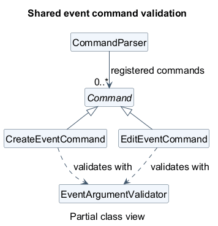
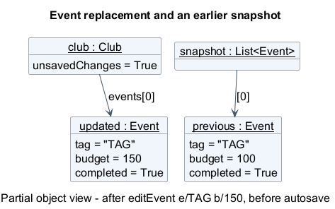
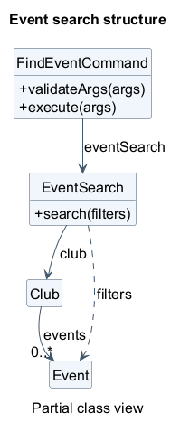
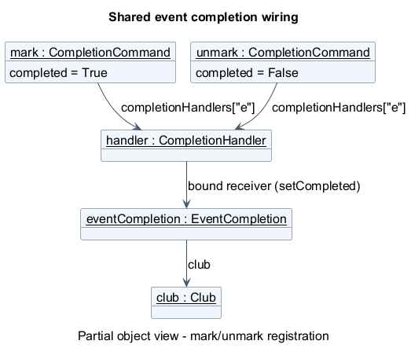

# Developer Guide

ClubFlow is a Java command-line application for helping student clubs manage
events, members, and related information. This guide describes the current implementation;
command examples are also available in the [User Guide](UserGuide.md).

## Contents

* [Acknowledgements](#acknowledgements)
* [Setting up, getting started](#setting-up-getting-started)
* [Design](#design)
* [Implementation](#implementation)
* [Documentation, logging, testing, and development workflow](#documentation-logging-testing-and-development-workflow)
* [Appendix: Requirements](#appendix-requirements)
* [Appendix: Instructions for manual testing](#appendix-instructions-for-manual-testing)

## Acknowledgements

* The organisation of this guide follows the
  [AddressBook Level 3 Developer Guide](https://se-education.org/addressbook-level3/DeveloperGuide.html) structure.
* [JUnit 5](https://junit.org/junit5/) provides the automated test framework.
* [Gradle](https://gradle.org/), [Shadow](https://gradleup.com/shadow/), and
  [Checkstyle](https://checkstyle.org/) support building, packaging, and style checks.
* [PlantUML](https://plantuml.com/) is used for UML diagrams.

## Setting up, getting started

Use JDK **25**, Git, and an IDE with Gradle support. Import the repository as a
Gradle project and select JDK 25 for both the project SDK and the Gradle JVM.
Run commands below from the repository root. On Windows, use PowerShell:

```powershell
java -version
.\gradlew.bat classes
java -ea -cp build/classes/java/main clubflow.ClubFlow
```

`classes` compiles the application. `-ea` enables assertions that check internal
assumptions. On macOS or Linux, replace `.\gradlew.bat` with `./gradlew`.
Alternatively, run `clubflow.ClubFlow.main()` in the IDE with assertions enabled.

To build the packaged application:

```powershell
.\gradlew.bat shadowJar
java -ea -cp build/libs/clubflow.jar clubflow.ClubFlow
```

**Current build configuration issue:** `build.gradle` sets `application.mainClass`
to `flow.ClubFlow`, but the actual entry point is `clubflow.ClubFlow`. Until that
setting is corrected, use the explicit classpath commands above rather than
`gradlew run` or `java -jar`. The root README also contains starter instructions
that do not describe the current application.

Paths such as `saves/`, `cache/`, and `clubflow.log` are relative to the process's
working directory. Launch from a separate folder for manual testing to avoid
changing development data.

## Design

### Architecture

<!-- Diagram widths use intrinsic pixels / 16 in em to match the body font size. -->
<div style="overflow-x: auto;">
  <a href="diagrams/Architecture.png"></a>
</div>

[PlantUML source](diagrams/Architecture.puml).

The following are logical responsibilities, not separate modules or a set of
component interfaces. Most core classes are in the `clubflow` package.

| Responsibility | Main classes | Purpose |
| --- | --- | --- |
| Application coordination | `ClubFlow` | Constructs and connects objects, loads startup data, runs the input loop, handles errors, and triggers autosave. |
| User interaction | `UserInterface` | Reads input and prints prompts, results, confirmation messages, and invitations. |
| Command processing | `CommandParser`, `Command`, concrete command classes, search and completion helpers | Resolves keywords and aliases, validates arguments, and executes requests, including event filtering and completion dispatch. |
| Club data | `Club`, `Event`, `Member`, `EventAssignment`, `Photo` | Holds the active club's data and maintains relationships. |
| Storage | `ClubManager`, `SaveLoadManager` | Selects club files, migrates legacy data, serializes records, and synchronizes photos. |

`ClubFlow` constructs one `UserInterface`, one `CommandParser`, one shared `Club`,
and one `ClubManager`. It creates command objects once and registers them with the
parser. Commands receive the objects they need through their constructors.

At startup, `ClubManager.initialize()` loads the default club. Each input-loop
iteration calls `UserInterface.prompt()` followed by `CommandParser.parse(input)`.
Commands print their results through the UI and return a boolean indicating
whether the application should exit. After parsing returns normally, `ClubFlow`
saves the active club if it has unsaved changes, then checks the exit flag.

### UI component

### Logic component

### Model component

### Storage component

### Common classes

There is no separate `commons` package. Shared command infrastructure and helpers
live alongside the commands; expected application failures use `clubflow.exception`.

#### Command contract

[`Command`](../src/main/java/clubflow/command/Command.java) is the shared extension
point for commands. Its argument declarations and syntax strings serve different
consumers: the parser enforces the declarations, while help displays the syntax.
Keep both consistent when changing a command.

[`CommandParser`](../src/main/java/clubflow/command/CommandParser.java) handles
input structure, required/allowed arguments, and repetition rules before calling
the command's `validateArgs()`. Keep field values and cross-field rules in the
command or a focused validator, rather than adding feature-specific branches to
the parser. The boolean returned by `execute()` requests application exit; it is
**not** a success or data-changed flag. Autosave instead relies on the shared club's
unsaved flag.

#### Shared event validation

[`EventArgumentIds`](../src/main/java/clubflow/command/EventArgumentIds.java) and
[`EventArgumentValidator`](../src/main/java/clubflow/command/EventArgumentValidator.java)
keep creation and editing aligned. The validator checks supplied event fields
before mutation, including rejecting the save format's `|` separator. When a
field rule changes, review both commands and the domain object's invariants.
Search has a different input contract (for example, no required event tag), so its
filter validation stays in `FindEventCommand` rather than reusing this validator.

<div style="overflow-x: auto;">
  <a href="diagrams/EventValidationClass.png"></a>
</div>

[PlantUML source](diagrams/EventValidationClass.puml).

#### Error handling

* [`ClubFlowException`](../src/main/java/clubflow/exception/ClubFlowException.java)
  is the checked base type for expected application failures and standardizes
  their messages. Propagate these failures to the input loop for display instead
  of printing an error and then throwing it, which would report it twice.
* [`CommandParseException`](../src/main/java/clubflow/exception/CommandParseException.java)
  covers invalid command input. Once a command is selected, the parser attaches
  its keyword so the input loop can also display the correct syntax.
* [`EventNotFoundException`](../src/main/java/clubflow/exception/EventNotFoundException.java)
  and [`DuplicateEventException`](../src/main/java/clubflow/exception/DuplicateEventException.java)
  distinguish failed event lookup from a conflicting tag. These are domain
  failures, not malformed command syntax.

Programming-contract violations, such as invalid command registration, use
unchecked exceptions rather than user-input errors. `ClubFlow` catches and logs
unexpected runtime exceptions at the input-loop boundary.

## Implementation

### Event management

Use the following entry points when changing event behavior. Command syntax and
user-visible rules belong in the [User Guide](UserGuide.md).

| Feature | Start here |
| --- | --- |
| Create | [CreateEventCommand](../src/main/java/clubflow/command/CreateEventCommand.java) |
| Delete | [DeleteEventCommand](../src/main/java/clubflow/command/DeleteEventCommand.java) |
| View | [ViewEventCommand](../src/main/java/clubflow/command/ViewEventCommand.java) |
| Edit | [EditEventCommand](../src/main/java/clubflow/command/EditEventCommand.java) |
| Find | [FindEventCommand](../src/main/java/clubflow/command/FindEventCommand.java), [EventSearch](../src/main/java/clubflow/search/EventSearch.java) |
| Completed/pending | [CompletionCommand](../src/main/java/clubflow/command/CompletionCommand.java), [EventCompletion](../src/main/java/clubflow/completion/EventCompletion.java) |

Commands share a long-lived [Club](../src/main/java/clubflow/Club.java). Look up
events on each request: retaining an event reference across requests can leave
a command using an old object after editing, marking, or loading data. Route
mutations through the club so relationship maintenance and autosave stay coordinated.

Deleting an event also removes its member assignments, so deletion changes both
the event list and the assignment roster.

The creation flow below ends before the input loop's autosave step.

<div style="overflow-x: auto;">
  <a href="diagrams/CreateEventSequence.png"></a>
</div>

[PlantUML source](diagrams/CreateEventSequence.puml).

#### Editing and replacement

Edits validate a replacement before installing it, avoiding partially applied
changes. The tradeoff is that replacing an event must preserve its position,
photos, and member assignments; this belongs in `Club.updateEvent()`.
When adding an event field, review both editing and completion copy paths,
the displayed/searchable details, and the save/load format together.

<div style="overflow-x: auto;">
  <a href="diagrams/EditEventSequence.png"></a>
</div>

[PlantUML source](diagrams/EditEventSequence.puml).
Autosave follows this flow; the club is marked saved only after persistence succeeds.

An earlier list returned by `getEvents()` still references the previous event;
the club's current list references the replacement instead.

<div style="overflow-x: auto;">
  <a href="diagrams/EventReplacementObject.png"></a>
</div>

[PlantUML source](diagrams/EventReplacementObject.puml).

#### Search

Search combines predicates over the current event snapshot. A linear scan keeps
ordering predictable and avoids maintaining indexes as events change. Keep
filter validation in `FindEventCommand` and matching in `EventSearch`; compile
filter values once per request. Consider indexing only if measured usage justifies
the additional update logic.

<div style="overflow-x: auto;">
  <a href="diagrams/EventSearchClass.png"></a>
</div>

[PlantUML source](diagrams/EventSearchClass.puml).

<div style="overflow-x: auto;">
  <a href="diagrams/FindEventSequence.png"></a>
</div>

[PlantUML source](diagrams/FindEventSequence.puml).

#### Completion

Mark and unmark share dispatch logic, with the desired state configured at
registration. The event handler owns lookup and replacement, keeping the command
independent of event details. Preserve idempotency: repeating a request must keep
the requested state, not toggle it. Completion uses the same replacement path as
editing, so both features must preserve unrelated data.

Both commands share a method-reference handler bound to the same `EventCompletion`
object, as shown below.

<div style="overflow-x: auto;">
  <a href="diagrams/CompletionWiringObject.png"></a>
</div>

[PlantUML source](diagrams/CompletionWiringObject.puml).

In the sequence diagram, `completed` is `True` for `mark` and `False` for `unmark`.

<div style="overflow-x: auto;">
  <a href="diagrams/CompletionSequence.png"></a>
</div>

[PlantUML source](diagrams/CompletionSequence.puml).

### Searching members

### Switching clubs without rebuilding commands

### Autosave, import, and file format

### Photo lifecycle and persistence limits

## Documentation, logging, testing, and development workflow

### Documentation

### Logging

### Automated testing and style checks

Event command regression tests are in
[`src/test/java/clubflow/command/`](../src/test/java/clubflow/command).
Prioritize checks across feature boundaries: editing a completed event, preserving
assignments/photos after replacement, fresh search results, and restart persistence.

```powershell
.\gradlew.bat test --tests 'clubflow.command.*Event*Test' --tests clubflow.command.CompletionCommandTest
```

### Extending commands and continuous integration

## Appendix: Requirements

### Product scope

#### Target user profile

#### Value proposition

### User Stories

### Use cases

For these use cases, the actor is a club organiser and the system is ClubFlow.

#### UC1: Edit an event

1. The organiser requests event details using its tag.
2. ClubFlow displays the event.
3. The organiser supplies the tag and at least one changed detail.
4. ClubFlow validates and replaces the event, then attempts autosave.

Extensions: an unknown tag or invalid detail produces an error without applying
the edit. An autosave failure leaves the edited data in memory and displays a warning.

#### UC2: Assign a member to an event

#### UC3: Switch clubs

#### UC4: Set an event's completion state

1. The organiser requests that an event be completed or pending.
2. ClubFlow applies the requested state and attempts to save any change.

Extensions: invalid input or an unknown event leaves data unchanged. Repeating
the request keeps the same state. A save failure is reported; the in-memory change
remains available for retry.

### Non-Functional Requirements

### Glossary

| Term | Meaning |
| --- | --- |
| Event tag | An event's identifier, matched without case within one club. |
| Unsaved flag | An indicator that the active data needs saving. |

## Appendix: Instructions for manual testing

Use Java 25 and a **new, empty working directory**. Launch the packaged application
with `java -ea -cp "<absolute-path-to-clubflow.jar>" clubflow.ClubFlow`, replacing
the placeholder with the actual JAR path. This uses the tested folder for saves,
photos, and logs. The cases below are a starting point for exploratory testing.

### Launch, help, and shutdown

### Event workflow

Start with an empty default club. This walkthrough checks interactions between
features; use the User Guide for full syntax and the automated tests for input boundaries.

1. Create `createEvent e/CAMP n/"Welcome Camp" b/100` and
   `createEvent e/TEMP`. Expect both to be pending.
2. Run `mark e/CAMP` twice, then `editEvent e/camp b/150`.
   Check with `viewEvent all`: completion and order are preserved.
3. Run `findEvent s/completed min/150 max/150`. Expect only `CAMP`.
4. Try `editEvent e/CAMP n/Changed b/-1` and `createEvent e/camp`.
   Expect errors with no partial edit or duplicate.
5. Restart and verify the completed state and edited budget. Run
   `unmark e/CAMP` twice and `deleteEvent e/temp`, then restart again.
   Expect `CAMP` to remain pending and `TEMP` to remain absent.

### Members, assignments, and deletion

### Multiple clubs and restart persistence

### Photo import and isolation

### Import and invalid save files

### Autosave failure and recovery
