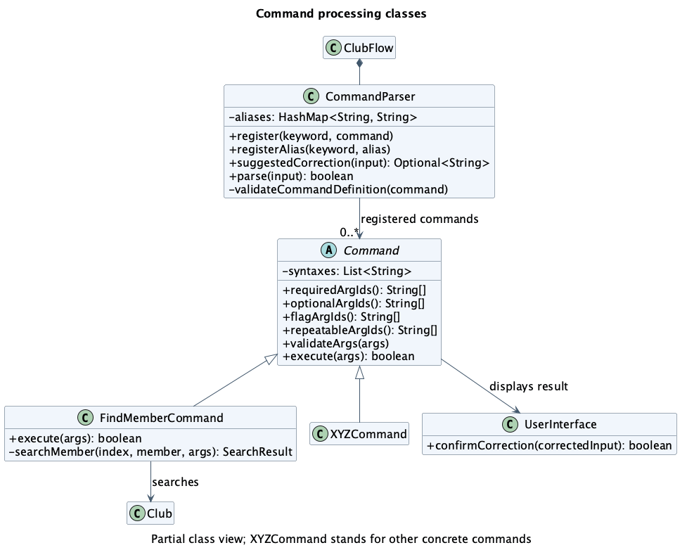

# Developer Guide

ClubFlow is a Java command-line application for helping student clubs manage
events, members, and related information. This guide describes the current implementation;
command examples are also available in the [User Guide](UserGuide.md).

## Contents

* [Acknowledgements](#acknowledgements)
* [Setting up, getting started](#setting-up-getting-started)
* [Design](#design)
* [Implementation](#implementation)
* [Documentation, logging, testing, dev-ops](#documentation-logging-testing-dev-ops)
* [Appendix A: Product Scope](#appendix-a-product-scope)
* [Appendix B: User Stories](#appendix-b-user-stories)
* [Appendix C: Non-Functional Requirements](#appendix-c-non-functional-requirements)
* [Appendix D: Glossary](#appendix-d-glossary)
* [Appendix E: Instructions for Manual Testing](#appendix-e-instructions-for-manual-testing)

## Acknowledgements

* The organisation of this guide follows the
  [AddressBook Level 3 Developer Guide](https://se-education.org/addressbook-level3/DeveloperGuide.html) structure.
* [JUnit 5](https://junit.org/junit5/) provides the automated test framework.
* [Gradle](https://gradle.org/), [Shadow](https://gradleup.com/shadow/), and
  [Checkstyle](https://checkstyle.org/) support building, packaging, and style checks.
* [PlantUML](https://plantuml.com/) is used for UML diagrams.
* This repository began with the [CS2113 Java project template](https://github.com/NUS-CS2113-AY2627-S1/tp).
  Its Gradle wrapper, build and CI scaffolding, and initial documentation templates
  were retained and adapted for ClubFlow; the event and member features described
  here were developed for this project.
* [ChatGPT](https://chatgpt.com/) was used to suggest edge cases and help generate
  JUnit tests for photo management, as recorded in the
  [photo feature contributor's portfolio](team/czfray.md). Those suggestions
  informed the project's photo tests.

## Setting up, getting started

Use JDK **25**, Git, and an IDE with Gradle support. Import the repository as a
Gradle project and select JDK 25 for both the project SDK and the Gradle JVM.
Run commands below from the repository root. On Windows, use PowerShell:

```powershell
java -version
.\gradlew.bat classes
java -ea -cp build/classes/java/main clubflow.ClubFlow
```

`classes` compiles the application. `-ea` enables assertions that check internal
assumptions. On macOS or Linux, replace `.\gradlew.bat` with `./gradlew`.
Alternatively, run `clubflow.ClubFlow.main()` in the IDE with assertions enabled.

To build the packaged application:

```powershell
.\gradlew.bat shadowJar
java -ea -cp build/libs/clubflow.jar clubflow.ClubFlow
```

**Current build configuration issue:** `build.gradle` sets `application.mainClass`
to `flow.ClubFlow`, but the actual entry point is `clubflow.ClubFlow`. Until that
setting is corrected, use the explicit classpath commands above rather than
`gradlew run` or `java -jar`. The root README also contains starter instructions
that do not describe the current application.

Paths such as `saves/`, `cache/`, and `clubflow.log` are relative to the process's
working directory. Launch from a separate folder for manual testing to avoid
changing development data.

## Design

### Architecture

<!-- Diagram widths use intrinsic pixels / 16 in em to match the body font size. -->
<div style="overflow-x: auto;">
  <a href="diagrams/Architecture.png"></a>
</div>

[PlantUML source](diagrams/Architecture.puml).

The following are logical responsibilities, not separate modules or a set of
component interfaces. Most core classes are in the `clubflow` package.

| Responsibility | Main classes | Purpose |
| --- | --- | --- |
| Application coordination | `ClubFlow` | Constructs and connects objects, loads startup data, runs the input loop, handles errors, and triggers autosave. |
| User interaction | `UserInterface` | Reads input and prints prompts, results, confirmation messages, and invitations. |
| Command processing | `CommandParser`, `Command`, concrete command classes, search and completion helpers | Resolves keywords and aliases, validates arguments, and executes requests, including event filtering and completion dispatch. |
| Club data | `Club`, `Event`, `Member`, `EventAssignment`, `Photo` | Holds the active club's data and maintains relationships. |
| Storage | `ClubManager`, `SaveLoadManager` | Selects club files, migrates legacy data, serializes records, and synchronizes photos. |

`ClubFlow` constructs one `UserInterface`, one `CommandParser`, one shared `Club`,
and one `ClubManager`. It creates command objects once and registers them with the
parser. Commands receive the objects they need through their constructors.

At startup, `ClubManager.initialize()` loads the default club. Each input-loop
iteration reads a line with `UserInterface.prompt()`, checks for a suggested
command spelling, and then calls `CommandParser.parse(input)`. A suggested
spelling requires confirmation before parsing; cancellation returns to the
prompt. Commands print their results through the UI and return a boolean
indicating whether the application should exit. After parsing returns normally,
`ClubFlow` saves the active club if it has unsaved changes, then checks the exit
flag.

### UI component

### Logic component

Main entry point: [CommandParser.java](../src/main/java/clubflow/command/CommandParser.java).

At startup, `ClubFlow` creates command objects and registers each keyword and
alias with `CommandParser`. An alias points to the same command object as its
full keyword; commands are not rebuilt for each input line. The diagram below
shows a partial class view of command processing.

<div style="overflow-x: auto;">
  <a href="diagrams/LogicClass.png"></a>
</div>

[PlantUML source](diagrams/LogicClass.puml). `XYZCommand` represents the many
concrete commands omitted from the diagram. The `+` and `-` markers denote
public and private members respectively; only members relevant to command
processing are shown.

How the Logic component processes input:

1. The input loop calls `suggestedCorrection(input)`. For an unknown command word
   of at least four characters, the parser may offer a uniquely closest full
   keyword within one or two character edits, depending on word length. It
   preserves the arguments. Exact keywords and aliases need no correction.
2. `UserInterface.confirmCorrection(...)` asks the user to press Enter to accept
   the suggestion or `c` to cancel it. A cancelled command is not parsed.
3. `CommandParser.parse(input)` identifies the keyword, preserves text inside
   double quotes while splitting arguments, and checks each argument ID against
   the command's required, optional, flag, and repeatable IDs.
4. The command validates its own rules in `validateArgs(...)` and then runs
   `execute(...)`. The [event creation sequence diagram](#event-management)
   shows this path for one concrete command. A successful execution returns
   `true` only when the application should exit.

An invalid command or argument raises `CommandParseException`. `ClubFlow`
displays the error and, when appropriate, the command syntax.

Each concrete command receives only the collaborators it needs, such as the
shared `Club`, `ClubManager`, or `UserInterface`. The parser knows the `Command`
contract, not each feature's data rules. Adding a command therefore requires
registering it in `ClubFlow` and declaring its arguments in the command class;
the [extension notes](#extending-commands-and-continuous-integration) describe
the checks to make when doing so.

### Model component

### Storage component

### Common classes

The `clubflow.exception` package contains application exceptions, including
`ClubFlowException` and `CommandParseException`. `ClubFlow` displays expected
command failures and can print the selected command's syntax for parsing errors.
It also catches unexpected runtime exceptions and records them in the log.
There is no separate `commons` package.

## Implementation

This section describes noteworthy details of selected implemented features.

### Event management

Use the following entry points when changing event behavior. Command syntax and
user-visible rules belong in the [User Guide](UserGuide.md).

| Feature | Start here |
| --- | --- |
| Create | [CreateEventCommand](../src/main/java/clubflow/command/CreateEventCommand.java) |
| Delete | [DeleteEventCommand](../src/main/java/clubflow/command/DeleteEventCommand.java) |
| View | [ViewEventCommand](../src/main/java/clubflow/command/ViewEventCommand.java) |
| Edit | [EditEventCommand](../src/main/java/clubflow/command/EditEventCommand.java) |
| Find | [FindEventCommand](../src/main/java/clubflow/command/FindEventCommand.java), [EventSearch](../src/main/java/clubflow/search/EventSearch.java) |
| Completed/pending | [CompletionCommand](../src/main/java/clubflow/command/CompletionCommand.java), [EventCompletion](../src/main/java/clubflow/completion/EventCompletion.java) |

Commands share a long-lived [Club](../src/main/java/clubflow/Club.java). Look up
events on each request: retaining an event reference across requests can leave
a command using an old object after editing, marking, or loading data. Route
mutations through the club so relationship maintenance and autosave stay coordinated.

Deleting an event also removes its member assignments, so deletion changes both
the event list and the assignment roster.

The creation flow below ends before the input loop's autosave step.

<div style="overflow-x: auto;">
  <a href="diagrams/CreateEventSequence.png"></a>
</div>

[PlantUML source](diagrams/CreateEventSequence.puml).

#### Editing and replacement

Edits validate a replacement before installing it, avoiding partially applied
changes. The tradeoff is that replacing an event must preserve its position,
photos, and member assignments; this belongs in `Club.updateEvent()`.
When adding an event field, review both editing and completion copy paths,
the displayed/searchable details, and the save/load format together.

<div style="overflow-x: auto;">
  <a href="diagrams/EditEventSequence.png"></a>
</div>

[PlantUML source](diagrams/EditEventSequence.puml).
Autosave follows this flow; the club is marked saved only after persistence succeeds.

#### Search

Search combines predicates over the current event snapshot. A linear scan keeps
ordering predictable and avoids maintaining indexes as events change. Keep
filter validation in `FindEventCommand` and matching in `EventSearch`; compile
filter values once per request. Consider indexing only if measured usage justifies
the additional update logic.

<div style="overflow-x: auto;">
  <a href="diagrams/FindEventSequence.png"></a>
</div>

[PlantUML source](diagrams/FindEventSequence.puml).

#### Completion

Mark and unmark share dispatch logic, with the desired state configured at
registration. The event handler owns lookup and replacement, keeping the command
independent of event details. Preserve idempotency: repeating a request must keep
the requested state, not toggle it. Completion uses the same replacement path as
editing, so both features must preserve unrelated data.

In the diagram, `completed` is `True` for `mark` and `False` for `unmark`.

<div style="overflow-x: auto;">
  <a href="diagrams/CompletionSequence.png"></a>
</div>

[PlantUML source](diagrams/CompletionSequence.puml).

#### Event invitations

`InviteCommand` implements `invite e/TAG`. It looks up the event in the active
club and formats its name, date, and venue as a copyable text invitation.
Missing optional details become visible placeholders so the organiser can
complete the message before sharing it. `UserInterface.printWithoutPrefix(...)`
prints the invitation block without the usual `[CF]` prefix on every line.
This command only reads event data; an unknown tag raises
`EventNotFoundException` and produces no invitation. The invitation is for an
event and contains text only; it does not attach event photos or send messages.

### Searching members

`FindMemberCommand` searches the current `Club.getMembers()` snapshot on every
request. It does not retain a result list, so a later edit, deletion, or club
switch is reflected in the next search. Results carry the member's **current
one-based index**, which can then be used by `editMember`, `assignMember`, or
`deleteMember`. A deletion can change later indices; clients must obtain a fresh
index before acting again.

The parser accepts repeated `q/` and `f/` arguments. `Command.getArgumentValues(...)`
recovers their separate values, and `searchMember(...)` requires **every** supplied
filter to match. For `q/`, the command takes the best match across name, Telegram,
email, and functions; `n/`, `t/`, `e/`, and `f/` restrict matching to their named
fields. Matching ignores case and surrounding whitespace. The command also
accepts a leading `@` in Telegram searches.

Direct matches receive scores of 300 for exact, 200 for prefix, and 100 for
substring matches. Scores from multiple filters are added; ties keep member-list
order through the stored index. If a name or Telegram handle has no direct match,
a four- or five-character query may have one spelling edit, while a query of six
to 64 characters may have two. The bounded edit-distance calculation compares
whole names and individual name words; email and functions remain strict.
Members requiring any spelling tolerance appear under **Possible matches**,
separate from direct results, with at most five suggestions shown.

This design favors understandable, current results over a search index that would
have to be maintained after every edit and club switch. Possible matches are
never selected automatically: the user checks the displayed contact details and
index before issuing a command that changes data.

### Switching clubs without rebuilding commands

### Autosave, import, and file format

### Photo lifecycle and persistence limits

## Documentation, logging, testing, dev-ops

### Documentation

The [User Guide](UserGuide.md) is where command syntax, examples, and
user-visible behavior belong. This Developer Guide explains responsibilities, data
flows, design choices, and a short manual test path. The repository
[README](../README.md) includes Gradle and IDE setup notes, although its
starter application example still needs updating. When changing a command,
update its UG entry and this guide's affected diagrams or test steps in the
same change so that the published instructions describe the code.

The diagrams embedded here are generated from the `.puml` sources in
[`docs/diagrams`](diagrams/). Keep the source and rendered image together, and
prefer a small diagram focused on one question over listing every command class.

### Logging

### Automated testing and style checks

Event command regression tests are in
[`src/test/java/clubflow/command/`](../src/test/java/clubflow/command).
Prioritize checks across feature boundaries: editing a completed event, preserving
assignments/photos after replacement, fresh search results, and restart persistence.

```powershell
.\gradlew.bat test --tests 'clubflow.command.*Event*Test' --tests clubflow.command.CompletionCommandTest
```

### Extending commands and continuous integration

## Appendix A: Product Scope

### Target user profile

### Value proposition

## Appendix B: User Stories

These MVP stories are based on the team's brainstorming list. Overlapping ideas
about editing events and saving data have been combined. The stories below
describe features available in the current implementation.

Priorities: High (must have) - `* * *`, Medium (nice to have) - `* *`, Low
(unlikely to have) - `*`.

| Priority | As a ... | I want to ... | So that I can ... |
| --- | --- | --- | --- |
| `* * *` | interest group head | create an event with its name, date, venue, deadline, budget, and logistics | give the team a shared plan for its work |
| `* * *` | club organiser | view all events or one event's details and budget | check plans before changing them |
| `* * *` | event organiser | edit an event's date, deadline, budget, venue, logistics, or name | keep its record accurate when plans change |
| `* * *` | club organiser | delete an outdated event | remove plans that are no longer relevant |
| `* * *` | club manager | add and view members with their contact details and functions | keep an up-to-date membership record |
| `* * *` | club manager | edit a member's details | keep contact information and functions accurate |
| `* * *` | club manager | delete a former member | keep the roster current |
| `* * *` | event organiser | assign or unassign members and record their event roles | see who is responsible for an event |
| `* * *` | regular user | have club data load and save automatically | resume work after restarting without saving each change manually |
| `* * *` | first-time user | see available commands and the syntax of a chosen command in the help menu | use ClubFlow without opening the User Guide |
| `* *` | regular user | search events by keyword or other event details | locate an event without reading the whole list |
| `* *` | regular user | search members by name, contact, or function | locate the intended member without inspecting the whole roster |
| `* *` | club manager | mark events as completed and find completed events later | refer to past plans when organising new events |
| `* *` | manager of several clubs | create, list, and switch between separate club records | manage each club's information in one application |
| `* *` | event organiser | add, view, and remove event photos stored locally | keep visual records with their events |
| `* *` | regular user | use short command aliases | enter frequent commands more quickly |
| `* *` | regular user | confirm a suggested correction for a misspelled command | recover from a typo without re-entering its arguments |
| `* *` | event organiser | generate a copyable invitation using an event's saved details | share its name, date, and venue without retyping them |
| `* *` | regular user | see clear prompts and visually distinct command results | read the command-line interface more easily |

### Use cases

For all use cases below, the system is `ClubFlow` and the actor is the club
organiser, unless specified otherwise.

#### UC1: Create an event

**MSS**

1. The organiser requests to create an event with a tag and any desired details.
2. ClubFlow validates the details and checks that the tag is unique in the active club.
3. ClubFlow adds the event, displays its tag, and attempts to autosave the club.

Use case ends.

**Extensions**

* 2a. The tag is missing, a detail is invalid, or the tag already exists.
  * 2a1. ClubFlow shows an error and leaves the event list unchanged.

  Use case ends.
* 3a. Autosave fails.
  * 3a1. ClubFlow warns the organiser; the new event remains in memory for a
    later save attempt.

  Use case ends.

#### UC2: Edit an event

**MSS**

1. The organiser requests to view an event using its tag.
2. ClubFlow shows the event's details.
3. The organiser requests to edit that event with at least one changed detail.
4. ClubFlow validates and applies the changes while retaining the event's
   position, completion state, photos, and member assignments.
5. ClubFlow confirms the event tag and attempts autosave.

Use case ends.

**Extensions**

* 1a. The event tag is unknown.
  * 1a1. ClubFlow shows an error.

  Use case ends.
* 4a. A changed detail is invalid.
  * 4a1. ClubFlow shows an error without applying the edit.

  Use case ends.
* 5a. Autosave fails.
  * 5a1. ClubFlow warns the organiser; the edited event remains in memory.

  Use case ends.

#### UC3: Delete an event

**MSS**

1. The organiser requests to delete an event using its tag.
2. ClubFlow removes the event and its member assignments.
3. ClubFlow displays a confirmation and attempts autosave.

Use case ends.

**Extensions**

* 1a. The event tag is unknown.
  * 1a1. ClubFlow shows an error; no event or assignment is removed.

  Use case ends.
* 3a. Autosave fails.
  * 3a1. ClubFlow warns the organiser; the deletion remains in memory for a
    later save attempt.

  Use case ends.

#### UC4: Assign a member to an event

#### UC5: Switch clubs

#### UC6: Set an event's completion state

1. The organiser requests that an event be completed or pending.
2. ClubFlow applies the requested state and attempts to save any change.

Extensions: invalid input or an unknown event leaves data unchanged. Repeating
the request keeps the same state. A save failure is reported; the in-memory change
remains available for retry.

#### UC7: Import photos into an event

#### UC8: Import club data

## Appendix C: Non-Functional Requirements

## Appendix D: Glossary

| Term | Meaning |
| --- | --- |
| Event tag | An event's identifier, matched without case within one club. |
| Unsaved flag | An indicator that the active data needs saving. |

## Appendix E: Instructions for Manual Testing

Use Java 25 and a **new, empty working directory**. Launch the packaged application
with `java -ea -cp "<absolute-path-to-clubflow.jar>" clubflow.ClubFlow`, replacing
the placeholder with the actual JAR path. This uses the tested folder for saves,
photos, and logs. The cases below are a starting point for exploratory testing.

### Launch, help, and shutdown

### Event workflow

Start with an empty default club. Run these steps in order: the member workflow
below uses the `CAMP` event left by this one. The User Guide gives additional
command examples; automated tests cover input boundaries.

1. Creating and viewing events

   1. Prerequisites: The active default club has no events.
   2. Test case: Enter `createEvent e/CAMP n/"Welcome Camp" d/2026-12-25 b/100 v/"Main Hall"`,
      `createEvent e/TEMP`, then `viewEvent all`.
   3. Expected: Both events appear in creation order with `Not completed` status.

2. Generating an invitation

   1. Test case: Enter `invite e/CAMP`.
   2. Expected: A copyable text invitation names `Welcome Camp` and contains
      `Date: 2026-12-25` and `Location: Main Hall`.
   3. Test case: Enter `invite e/UNKNOWN`.
   4. Expected: ClubFlow reports that the event is not found and prints no invitation.

3. Correcting a command keyword

   1. Test case: Enter `invte e/CAMP`, then press Enter at the confirmation prompt.
   2. Expected: ClubFlow suggests `invite e/CAMP` and prints the invitation.
   3. Test case: Enter `invte e/CAMP` again, then enter `c` at the prompt.
   4. Expected: ClubFlow prints `Command cancelled.` and does not print an
      invitation for the cancelled command.

4. Editing, completing, and finding an event

   1. Test case: Enter `mark e/CAMP` twice and `editEvent e/camp b/150`, then
      `viewEvent e/CAMP` and `viewEvent all`.
   2. Expected: `CAMP` has a `$150.00` budget and `Completed` status. It still
      appears before `TEMP`.
   3. Test case: Enter `findEvent s/completed min/150 max/150`, then
      `findEvent q/Welcome`.
   4. Expected: Both searches find `CAMP`.

5. Rejecting invalid event changes

   1. Test case: Enter `editEvent e/CAMP n/Changed b/-1` and `createEvent e/camp`,
      then `viewEvent e/CAMP`.
   2. Expected: Both changes produce errors. `CAMP` retains its `Welcome Camp`
      name and `$150.00` budget; no duplicate is created.

6. Checking restart persistence and deletion

   1. Test case: Enter `exit`, restart from the same working directory, then
      `viewEvent e/CAMP`.
   2. Expected: The edited budget and completion state persist.
   3. Test case: Enter `unmark e/CAMP` twice and `deleteEvent e/temp`, then
      `exit`, restart, and enter `viewEvent all`.
   4. Expected: `CAMP` is `Not completed` and `TEMP` is absent.

### Members, assignments, and deletion

Continue in the same working directory after the event workflow. Search results
report current member indices; obtain a fresh index after deleting a member.

1. Creating and finding members

   1. Prerequisites: `CAMP` exists and the active club has no members.
   2. Test case: Enter `createMember n/"Alice Tan" t/alice f/Logistics`,
      `createMember n/"Bob Lim" e/bob@example.com f/Finance`, then `viewMember`.
   3. Expected: Alice is index 1 and Bob is index 2, with their respective
      contact and function details.
   4. Test case: Enter `findMember q/alce`, `findMember f/Finance`, then
      `findMember n/"Alice Tan" f/Logistics`.
   5. Expected: Alice appears under `Possible matches` for `q/alce`; Bob is a
      direct match at index 2 for `f/Finance`; both filters match Alice directly
      in the final search.

2. Assigning and editing a member

   1. Test case: Enter `assignMember e/CAMP i/1 r/"Lead Host"`, then
      `viewEvent e/CAMP`.
   2. Expected: Alice appears in the assigned members section with that role.
   3. Test case: Enter `editMember i/1 n/"Alicia Tan"`, then `viewEvent e/CAMP`
      and `viewMember`.
   4. Expected: The same assignment shows Alicia, still at member index 1.

3. Unassigning and deleting a member

   1. Test case: Enter `unassignMember e/CAMP i/1`, then `viewEvent e/CAMP`.
   2. Expected: Alicia is no longer assigned. Enter `assignMember e/CAMP i/1`
      to set up the deletion check.
   3. Test case: Enter `deleteMember i/2`, then enter `n` at its confirmation
      prompt. Run `viewMember`.
   4. Expected: Both members remain.
   5. Test case: Enter `deleteMember i/1 /f`, then `viewMember` and
      `viewEvent e/CAMP`. Restart from the same working directory and check again.
   6. Expected: Only Bob remains, now at index 1. The deleted member no longer
      appears in the event assignment. Both changes persist after restart.

### Multiple clubs and restart persistence

### Photo import and isolation

### Import and invalid save files

### Autosave failure and recovery
