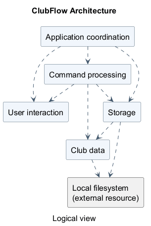
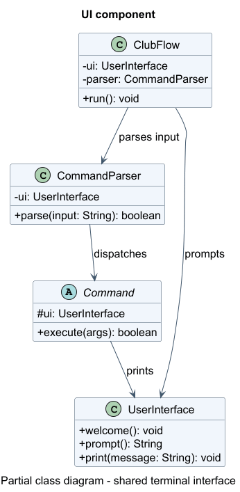
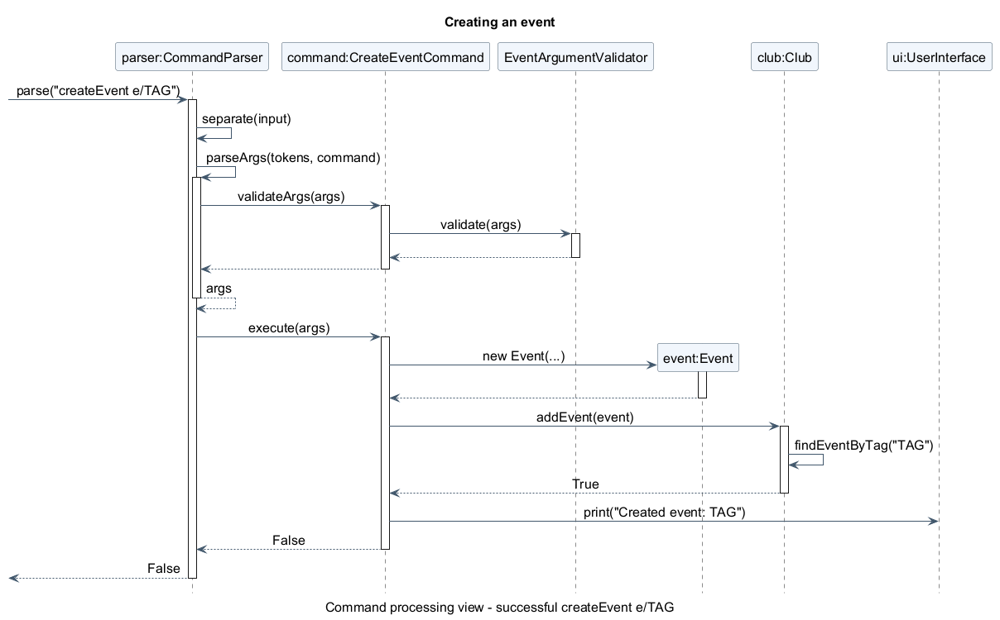
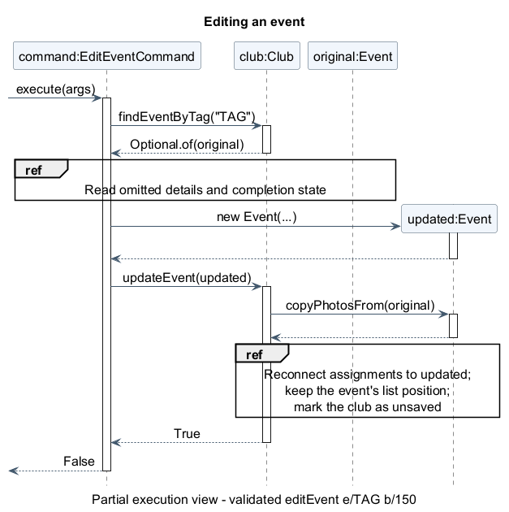
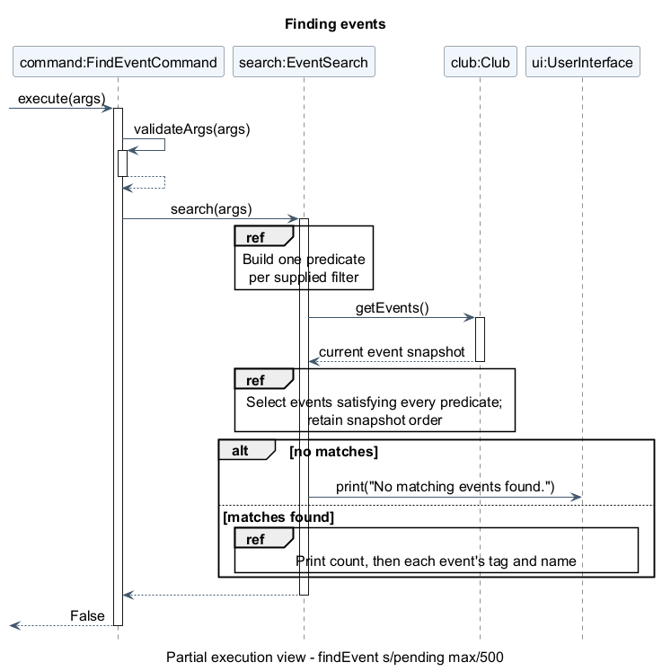
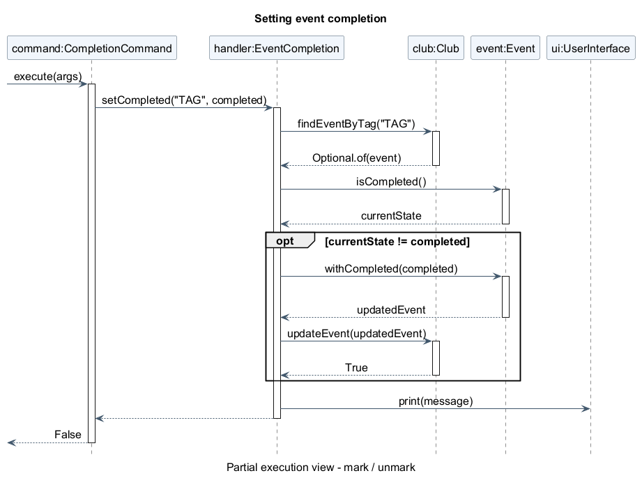
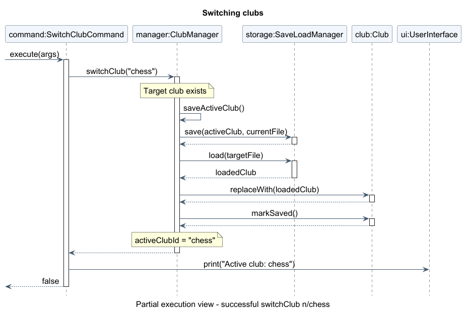

# Developer Guide

ClubFlow is a Java command-line application for helping student clubs manage
events, members, and related information. This guide describes the current implementation;
command examples are also available in the [User Guide](UserGuide.md).

## Contents

* [Acknowledgements](#acknowledgements)
* [Setting up, getting started](#setting-up-getting-started)
* [Design](#design)
* [Implementation](#implementation)
* [Documentation, logging, testing, and development workflow](#documentation-logging-testing-and-development-workflow)
* [Appendix A: Product Scope](#appendix-a-product-scope)
* [Appendix B: User Stories](#appendix-b-user-stories)
* [Appendix C: Non-Functional Requirements](#appendix-c-non-functional-requirements)
* [Appendix D: Glossary](#appendix-d-glossary)
* [Appendix E: Instructions for Manual Testing](#appendix-e-instructions-for-manual-testing)

## Acknowledgements

* The organisation of this guide follows the
  [AddressBook Level 3 Developer Guide](https://se-education.org/addressbook-level3/DeveloperGuide.html) structure.
* [JUnit 5](https://junit.org/junit5/) provides the automated test framework.
* [Gradle](https://gradle.org/), [Shadow](https://gradleup.com/shadow/), and
  [Checkstyle](https://checkstyle.org/) support building, packaging, and style checks.
* [PlantUML](https://plantuml.com/) is used for UML diagrams.

## Setting up, getting started

Use JDK **25**, Git, and an IDE with Gradle support. Import the repository as a
Gradle project and select JDK 25 for both the project SDK and the Gradle JVM.
Run commands below from the repository root. On Windows, use PowerShell:

```powershell
java -version
.\gradlew.bat classes
java -ea -cp build/classes/java/main clubflow.ClubFlow
```

`classes` compiles the application. `-ea` enables assertions that check internal
assumptions. On macOS or Linux, replace `.\gradlew.bat` with `./gradlew`.
Alternatively, run `clubflow.ClubFlow.main()` in the IDE with assertions enabled.

To build the packaged application:

```powershell
.\gradlew.bat shadowJar
java -ea -cp build/libs/clubflow.jar clubflow.ClubFlow
```

**Current build configuration issue:** `build.gradle` sets `application.mainClass`
to `flow.ClubFlow`, but the actual entry point is `clubflow.ClubFlow`. Until that
setting is corrected, use the explicit classpath commands above rather than
`gradlew run` or `java -jar`. The root README also contains starter instructions
that do not describe the current application.

Paths such as `saves/`, `cache/`, and `clubflow.log` are relative to the process's
working directory. Launch from a separate folder for manual testing to avoid
changing development data.

## Design

### Architecture

<!-- Diagram widths use intrinsic pixels / 16 in em to match the body font size. -->
<div style="overflow-x: auto;">
  <a href="diagrams/Architecture.png"></a>
</div>

[PlantUML source](diagrams/Architecture.puml).

The following are logical responsibilities, not separate modules or a set of
component interfaces. Most core classes are in the `clubflow` package.

| Responsibility | Main classes | Purpose |
| --- | --- | --- |
| Application coordination | `ClubFlow` | Constructs and connects objects, loads startup data, runs the input loop, handles errors, and triggers autosave. |
| User interaction | `UserInterface` | Reads input and prints prompts, results, confirmation messages, and invitations. |
| Command processing | `CommandParser`, `Command`, concrete command classes, search and completion helpers | Resolves keywords and aliases, validates arguments, and executes requests, including event filtering and completion dispatch. |
| Club data | `Club`, `Event`, `Member`, `EventAssignment`, `Photo` | Holds the active club's data and maintains relationships. |
| Storage | `ClubManager`, `SaveLoadManager` | Selects club files, migrates legacy data, serializes records, and synchronizes photos. |

`ClubFlow` constructs one `UserInterface`, one `CommandParser`, one shared `Club`,
and one `ClubManager`. It creates command objects once and registers them with the
parser. Commands receive the objects they need through their constructors.

At startup, `ClubManager.initialize()` loads the default club. Each input-loop
iteration calls `UserInterface.prompt()` followed by `CommandParser.parse(input)`.
Commands print their results through the UI and return a boolean indicating
whether the application should exit. After parsing returns normally, `ClubFlow`
saves the active club if it has unsaved changes, then checks the exit flag.

### UI component

ClubFlow has a **terminal UI**, not a graphical interface. Its concrete UI is
[`UserInterface`](../src/main/java/clubflow/UserInterface.java), which handles
text input and output but does not own or modify club data.

* `ClubFlow` creates one `UserInterface` with the output prefix `[CF] ` and the
  input prompt `> `. It calls `welcome()` once and `prompt()` for each command.
* `UserInterface` reads a complete line using a `Scanner` over `System.in`.
  The same line is passed to `CommandParser.parse(...)` by `ClubFlow`.
* Commands and the parser share that UI object. They call `print(message)` for
  results, error explanations, and syntax help. `print(message, indentLevel)`
  adds two spaces per level after `[CF] `; `printWithoutPrefix(text)` is available
  for content that users need to copy without the prefix.
* The welcome banner contains ANSI true-colour escape sequences. Its colours
  depend on terminal support; the prompts and command output remain ordinary text.
* `ClubFlow` handles expected command exceptions and prints their messages.
  `CommandParseException` can also cause the correct command syntax to be shown.
  Unexpected runtime exceptions are logged by `ClubFlow`.

The following class diagram is intentionally limited to UI interaction. It
shows that `UserInterface` is shared rather than recreated for every command.



[PlantUML source](diagrams/UiClassDiagram.puml).

**Design consideration:** keeping input and printing in one small class makes
terminal formatting consistent. Commands currently print through this class
instead of returning presentation-independent results, however, so replacing
the terminal with a GUI would require changes in command execution or an
adapter. Tests that exercise the real input loop redirect `System.in` and
capture `System.out` for this reason.

### Logic component

### Model component

### Storage component

### Common classes

The `clubflow.exception` package contains application exceptions, including
`ClubFlowException` and `CommandParseException`. `ClubFlow` displays expected
command failures and can print the selected command's syntax for parsing errors.
It also catches unexpected runtime exceptions and records them in the log.
There is no separate `commons` package.

## Implementation

### Event management

Use the following entry points when changing event behavior. Command syntax and
user-visible rules belong in the [User Guide](UserGuide.md).

| Feature | Start here |
| --- | --- |
| Create | [CreateEventCommand](../src/main/java/clubflow/command/CreateEventCommand.java) |
| Delete | [DeleteEventCommand](../src/main/java/clubflow/command/DeleteEventCommand.java) |
| View | [ViewEventCommand](../src/main/java/clubflow/command/ViewEventCommand.java) |
| Edit | [EditEventCommand](../src/main/java/clubflow/command/EditEventCommand.java) |
| Find | [FindEventCommand](../src/main/java/clubflow/command/FindEventCommand.java), [EventSearch](../src/main/java/clubflow/search/EventSearch.java) |
| Completed/pending | [CompletionCommand](../src/main/java/clubflow/command/CompletionCommand.java), [EventCompletion](../src/main/java/clubflow/completion/EventCompletion.java) |

Commands share a long-lived [Club](../src/main/java/clubflow/Club.java). Look up
events on each request: retaining an event reference across requests can leave
a command using an old object after editing, marking, or loading data. Route
mutations through the club so relationship maintenance and autosave stay coordinated.

Deleting an event also removes its member assignments, so deletion changes both
the event list and the assignment roster.

The creation flow below ends before the input loop's autosave step.

<div style="overflow-x: auto;">
  <a href="diagrams/CreateEventSequence.png"></a>
</div>

[PlantUML source](diagrams/CreateEventSequence.puml).

#### Editing and replacement

Edits validate a replacement before installing it, avoiding partially applied
changes. The tradeoff is that replacing an event must preserve its position,
photos, and member assignments; this belongs in `Club.updateEvent()`.
When adding an event field, review both editing and completion copy paths,
the displayed/searchable details, and the save/load format together.

<div style="overflow-x: auto;">
  <a href="diagrams/EditEventSequence.png"></a>
</div>

[PlantUML source](diagrams/EditEventSequence.puml).
Autosave follows this flow; the club is marked saved only after persistence succeeds.

#### Search

Search combines predicates over the current event snapshot. A linear scan keeps
ordering predictable and avoids maintaining indexes as events change. Keep
filter validation in `FindEventCommand` and matching in `EventSearch`; compile
filter values once per request. Consider indexing only if measured usage justifies
the additional update logic.

<div style="overflow-x: auto;">
  <a href="diagrams/FindEventSequence.png"></a>
</div>

[PlantUML source](diagrams/FindEventSequence.puml).

#### Completion

Mark and unmark share dispatch logic, with the desired state configured at
registration. The event handler owns lookup and replacement, keeping the command
independent of event details. Preserve idempotency: repeating a request must keep
the requested state, not toggle it. Completion uses the same replacement path as
editing, so both features must preserve unrelated data.

In the diagram, `completed` is `True` for `mark` and `False` for `unmark`.

<div style="overflow-x: auto;">
  <a href="diagrams/CompletionSequence.png"></a>
</div>

[PlantUML source](diagrams/CompletionSequence.puml).

### Searching members

### Switching clubs without rebuilding commands

ClubFlow supports multiple clubs, while keeping the same parser, command
objects, and in-memory [`Club`](../src/main/java/clubflow/Club.java) instance.
This is important because event and member commands receive their `Club` in
their constructors at startup. Replacing the `Club` *reference* on a switch
would leave those commands pointing at the previous club's data.

The relevant classes are
[`ClubManager`](../src/main/java/clubflow/ClubManager.java),
[`CreateClubCommand`](../src/main/java/clubflow/command/CreateClubCommand.java),
[`SwitchClubCommand`](../src/main/java/clubflow/command/SwitchClubCommand.java),
[`ListClubsCommand`](../src/main/java/clubflow/command/ListClubsCommand.java), and
[`CurrentClubCommand`](../src/main/java/clubflow/command/CurrentClubCommand.java).

**Club creation and selection:**

1. A club ID is validated as letters, digits, `_` or `-` and normalised to
   lowercase using `Locale.ROOT`. `default` is reserved. Club IDs are used
   as directory names, so separators and parent-directory traversal are rejected.
2. `createClub` creates an initially empty `club.cf` file in
   `saves/clubs/<club-id>/`. It does **not** change the active club.
3. `listClubs` lists club directories containing a `club.cf` file; the default
   club is first, followed by other IDs in case-insensitive sorted order.
   `currentClub` reads the active ID from `ClubManager`.
4. The application starts in `default` on every launch. The last selected
   non-default club is **not** restored as the active club at the next launch.

**Switching:** `SwitchClubCommand.execute(...)` delegates to
`ClubManager.switchClub(targetId)`. The manager checks that the target file
exists and, unless it is already active, calls `saveActiveClub()` before
loading the target data with `SaveLoadManager.load(...)` into a temporary
`Club`. Only after the load succeeds does it call
`activeClub.replaceWith(loaded)` and change `activeClubId`. `replaceWith`
replaces the shared object's member, event, and assignment collections instead
of replacing the shared object itself. The unsaved flag is then cleared.
`SaveLoadManager` also saves the current club's photos to its own directory and
loads the target club's photos into the working cache.



[PlantUML source](diagrams/SwitchClubSequence.puml).

**Failure handling:** an unknown club raises `ClubNotFoundException`. Failure
to save or load displays an I/O error; the active ID is not changed. A
malformed target save file is rejected before the in-memory club is replaced.
A request to switch to the already active club is a no-op. A successful
switch does not invoke the input loop's normal dirty-data autosave because
the loaded club is marked saved.

**Design alternatives:** rebuilding all commands on every switch would avoid
shared mutable state, but requires rebuilding registrations and ensuring no
command retains stale dependencies. Using one shared `Club` with
`replaceWith(...)` keeps registrations stable and preserves existing
command constructors. The tradeoff is that commands and other collaborators
must not cache references to individual `Event` or `Member` instances across
switches. It also means only one club is loaded into the shared model at a
time.

### Autosave, import, and file format

### Photo lifecycle and persistence limits

## Documentation, logging, testing, and development workflow

### Documentation

### Logging

### Automated testing and style checks

ClubFlow uses JUnit 5 with the Gradle `test` task. Test source files live in
[`src/test/java/clubflow/`](../src/test/java/clubflow) and its `command`
subdirectory. `build.gradle` enables assertions when running tests, so internal
invariants are checked as well as externally visible results.

Testing is performed at different levels:

* **Command and parser tests:**
  [`ClubCommandsTest`](../src/test/java/clubflow/command/ClubCommandsTest.java)
  checks club command syntax, duplicate and invalid IDs, active-club output,
  and failure paths. Other command tests exercise events and members.
* **Storage/model tests:**
  [`ClubManagerTest`](../src/test/java/clubflow/ClubManagerTest.java)
  checks club creation, name normalisation, switching, save files, and legacy
  migration. [`MultiClubPhotoStorageTest`](../src/test/java/clubflow/MultiClubPhotoStorageTest.java)
  checks per-club photo snapshots.
* **End-to-end input-loop tests:**
  [`ClubFlowMultiClubTest`](../src/test/java/clubflow/ClubFlowMultiClubTest.java)
  submits lines to a fresh `ClubFlow`, captures terminal output, and starts
  another instance using the same test directory to check restart persistence
  and separation between clubs. The test supplies an alternate save path so it
  does not overwrite a user's real `saves/` directory.

JUnit's `@TempDir` provides disposable save-file locations in tests that
access the filesystem. UI integration tests temporarily replace `System.in`
and `System.out` and restore them after each test. This prevents tests from
requiring manual input and allows success and error messages to be asserted.

From the project root, run the whole suite and then the project's Checkstyle
rules (on macOS/Linux, use `./gradlew` in place of `.\gradlew.bat`):

```powershell
.\gradlew.bat test
.\gradlew.bat check
```

To run only the multiple-club regression tests:

```powershell
.\gradlew.bat test --tests clubflow.ClubManagerTest --tests clubflow.ClubFlowMultiClubTest --tests clubflow.command.ClubCommandsTest
```

Automated tests reduce regressions, but do not establish complete path or line
coverage by themselves. Manual tests are still needed for a real terminal,
photo viewers, permissions errors, and full release packaging. See
[Appendix E](#appendix-e-instructions-for-manual-testing).

### Extending commands and continuous integration

## Appendix: Requirements

## Appendix A: Product scope

### Target user profile

### Value proposition

ClubFlow gives organisers of student clubs a single, lightweight command-line
workspace for the information needed to run their activities:

* **Centralised event planning:** event dates, deadlines, budgets, venues,
  logistics, and completion state are recorded alongside member assignments.
* **Less repetitive administration:** organisers can look up events or members,
  update details through commands, and have changes saved without running a
  separate save command.
* **Separate clubs on one installation:** organisers helping more than one club
  can create and switch between independent club records. Reusing the same
  event tag in different clubs does not cause a conflict.
* **Event photo organisation:** photos are associated with events and saved
  with the owning club's data for later use.

The product is intended for local, offline record-keeping. It does not provide
shared live editing, cloud synchronisation, or automatic event notifications;
organisers coordinating across devices must transfer their files themselves.

## Appendix B: User stories

### Use cases

For these use cases, the actor is a club organiser and the system is ClubFlow.

#### UC2: Edit an event

1. The organiser requests event details using its tag.
2. ClubFlow displays the event.
3. The organiser supplies the tag and at least one changed detail.
4. ClubFlow validates and replaces the event, then attempts autosave.

Extensions: an unknown tag or invalid detail produces an error without applying
the edit. An autosave failure leaves the edited data in memory and displays a warning.

#### UC4: Assign a member to an event

**MSS (main success scenario)**

1. The organiser has an event and a member in the active club.
2. The organiser uses `viewMember` to find the member's current one-based index.
3. The organiser enters `assignMember e/TAG i/INDEX` with an optional `r/ROLE`.
4. ClubFlow verifies that the event and member exist and that the assignment
   does not already exist.
5. ClubFlow creates the assignment, displays a confirmation, and attempts to
   autosave the active club.
6. The organiser can use `viewEvent e/TAG` to inspect the assigned member and role.

**Extensions:** an unknown event or member is reported without making an
assignment. An already-assigned member is not assigned twice. An invalid index
or role is rejected. If autosave fails, ClubFlow warns the organiser and keeps
the change in memory for another save attempt.

#### UC5: Switch clubs

**MSS (main success scenario)**

1. The organiser has created a second club using `createClub n/ID`.
2. The organiser runs `listClubs` to check the available clubs.
3. The organiser enters `switchClub n/ID` for a club other than the active one.
4. ClubFlow saves the current club and loads the selected club's records.
5. ClubFlow updates the shared in-memory data and makes the selected club active.
6. ClubFlow displays `Active club: id`. The organiser can verify the choice
   using `currentClub` and view the new club's events and members.

**Extensions:** an invalid ID is rejected by the parser; an unknown ID is
reported without switching. If saving the current club or loading the target
fails, the active club does not change. Switching to the already active club
simply reports that club. On restart, ClubFlow loads `default`, not the club
that was last active.

#### UC6: Set an event's completion state

1. The organiser requests that an event be completed or pending.
2. ClubFlow applies the requested state and attempts to save any change.

Extensions: invalid input or an unknown event leaves data unchanged. Repeating
the request keeps the same state. A save failure is reported; the in-memory change
remains available for retry.

## Appendix C: Non-functional requirements

The following requirements describe the intended v2.1 release. They are stated
in terms that a tester or maintainer can check:

1. **Operating environment:** ClubFlow must run from a terminal with JDK 25,
   without requiring a GUI framework, a database server, or an internet
   connection. The release JAR must launch using the documented command.
2. **Input and error handling:** an invalid command or an unknown club must
   produce a readable explanation without terminating an otherwise usable
   command session. Recoverable I/O failures must be reported to the user.
3. **Club isolation:** events, members, assignments, and photos belonging to
   one club must not appear when a different club is selected. The same event
   tag may be used independently in two clubs.
4. **Persistent local data:** club records must be stored in distinct local
   club directories and must remain available after closing and restarting
   the application, provided the save succeeded. On startup the app must
   select `default`.
5. **Data integrity:** rejecting an invalid target save file must not replace
   the currently loaded member, event, or assignment records. Duplicate club
   IDs differing only in case must not create a second club.
6. **Maintainability:** Java source and test code must follow the repository's
   Checkstyle rules, and the documented regression commands must be runnable
   through Gradle with JUnit 5.
7. **Portability of saved data:** club records and associated photos must be
   transferable by copying the appropriate club directory while ClubFlow is
   not running. The user guide must identify the required paths.

## Appendix D: Glossary

| Term | Meaning |
| --- | --- |
| Event tag | An event's identifier, matched without case within one club. |
| Unsaved flag | An indicator that the active data needs saving. |

## Appendix E: Instructions for manual testing

Use Java 25 and a **new, empty working directory**. Launch the packaged application
with `java -ea -cp "<absolute-path-to-clubflow.jar>" clubflow.ClubFlow`, replacing
the placeholder with the actual JAR path. This uses the tested folder for saves,
photos, and logs. The cases below are a starting point for exploratory testing.

### Launch, help, and shutdown

### Event workflow

Start with an empty default club. This walkthrough checks interactions between
features; use the User Guide for full syntax and the automated tests for input boundaries.

1. Create `createEvent e/CAMP n/"Welcome Camp" b/100` and
   `createEvent e/TEMP`. Expect both to be pending.
2. Run `mark e/CAMP` twice, then `editEvent e/camp b/150`.
   Check with `viewEvent all`: completion and order are preserved.
3. Run `findEvent s/completed min/150 max/150`. Expect only `CAMP`.
4. Try `editEvent e/CAMP n/Changed b/-1` and `createEvent e/camp`.
   Expect errors with no partial edit or duplicate.
5. Restart and verify the completed state and edited budget. Run
   `unmark e/CAMP` twice and `deleteEvent e/temp`, then restart again.
   Expect `CAMP` to remain pending and `TEMP` to remain absent.

### Members, assignments, and deletion

### Multiple clubs and restart persistence

Perform this sequence in a **fresh, empty working directory** so existing
club data is not affected. Commands use exact formats from the User Guide.

1. Enter `currentClub`, then `listClubs`. Expect `Active club: default`
   and `default (active)` in the list.
2. Enter `createEvent e/AGM n/DefaultMeeting` and
   `createMember n/Alice t/alice`. These belong to `default`.
3. Enter `createClub n/chess` and then `listClubs`. Expect `chess` to appear,
   but `default` to remain active.
4. Enter `createClub n/CHESS`. Expect a duplicate-club error. Then enter
   `switchClub n/chess` and `currentClub`. Expect `Active club: chess`.
5. Enter `viewEvent all` and `viewMember`. Expect `No events found.` and
   `No members found.`; the default club's records must not appear.
6. Enter `createEvent e/AGM n/ChessMeeting` and
   `createMember n/Bob t/bob`. The same event tag is allowed in this club.
7. Enter `switchClub n/default`, `viewEvent e/AGM`, and `viewMember`.
   Expect `DefaultMeeting` and `Alice`, but not `ChessMeeting` or `Bob`.
8. Enter `switchClub n/chess`, `viewEvent e/AGM`, and `viewMember`.
   Expect `ChessMeeting` and `Bob`, but not the default club's records.
9. Enter `switchClub n/missing` and `currentClub`. Expect `Club not found:
   missing` and the active club to remain `chess`. Enter
   `switchClub n/../invalid`; expect an invalid-ID explanation.
10. Enter `exit` and relaunch ClubFlow from the same working directory.
    `currentClub` should display `default`. Check that `DefaultMeeting` and
    `Alice` remain, then switch to `chess` and check that `ChessMeeting`
    and `Bob` remain. The distinct save files should exist at
    `saves/clubs/default/club.cf` and `saves/clubs/chess/club.cf`.

### Photo import and isolation

### Import and invalid save files

### Autosave failure and recovery
