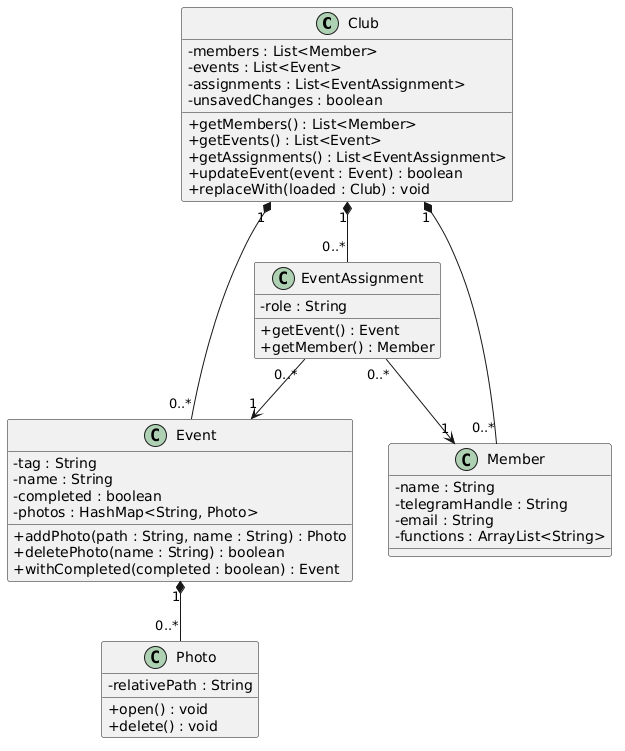
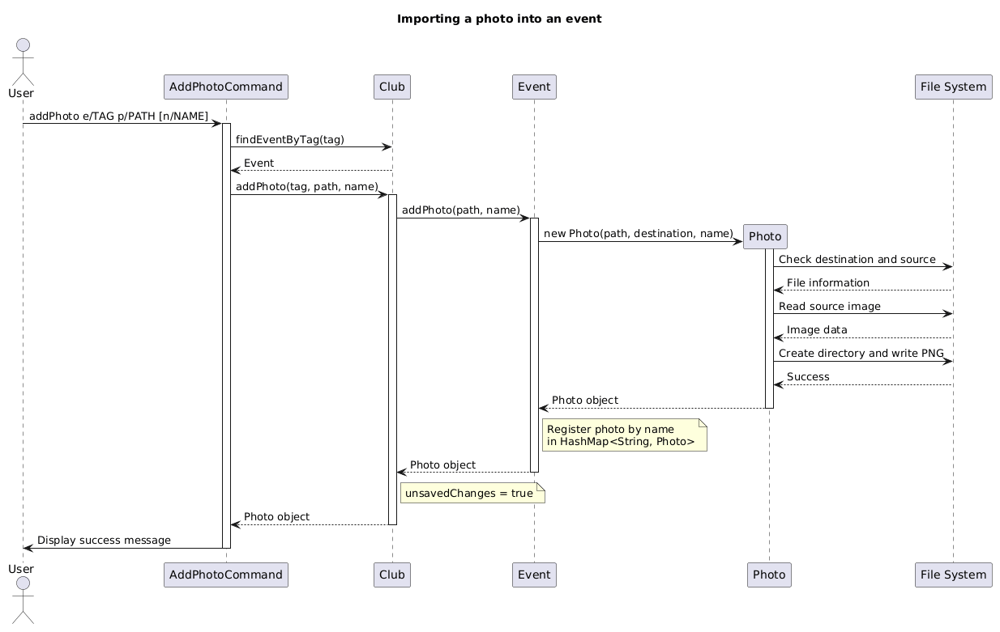

# Developer Guide

ClubFlow is a Java command-line application for helping student clubs manage
events, members, and related information. This guide describes the current implementation;
command examples are also available in the [User Guide](UserGuide.md).

## Contents

* [Acknowledgements](#acknowledgements)
* [Setting up, getting started](#setting-up-getting-started)
* [Design](#design)
* [Implementation](#implementation)
* [Documentation, logging, testing, and development workflow](#documentation-logging-testing-and-development-workflow)
* [Appendix: Requirements](#appendix-requirements)
* [Appendix: Instructions for manual testing](#appendix-instructions-for-manual-testing)

## Acknowledgements

* The organisation of this guide follows the
  [AddressBook Level 3 Developer Guide](https://se-education.org/addressbook-level3/DeveloperGuide.html) structure.
* [JUnit 5](https://junit.org/junit5/) provides the automated test framework.
* [Gradle](https://gradle.org/), [Shadow](https://gradleup.com/shadow/), and
  [Checkstyle](https://checkstyle.org/) support building, packaging, and style checks.
* [PlantUML](https://plantuml.com/) is used for UML diagrams.

## Setting up, getting started

Use JDK **25**, Git, and an IDE with Gradle support. Import the repository as a
Gradle project and select JDK 25 for both the project SDK and the Gradle JVM.
Run commands below from the repository root. On Windows, use PowerShell:

```powershell
java -version
.\gradlew.bat classes
java -ea -cp build/classes/java/main clubflow.ClubFlow
```

`classes` compiles the application. `-ea` enables assertions that check internal
assumptions. On macOS or Linux, replace `.\gradlew.bat` with `./gradlew`.
Alternatively, run `clubflow.ClubFlow.main()` in the IDE with assertions enabled.

To build the packaged application:

```powershell
.\gradlew.bat shadowJar
java -ea -cp build/libs/clubflow.jar clubflow.ClubFlow
```

**Current build configuration issue:** `build.gradle` sets `application.mainClass`
to `flow.ClubFlow`, but the actual entry point is `clubflow.ClubFlow`. Until that
setting is corrected, use the explicit classpath commands above rather than
`gradlew run` or `java -jar`. The root README also contains starter instructions
that do not describe the current application.

Paths such as `saves/`, `cache/`, and `clubflow.log` are relative to the process's
working directory. Launch from a separate folder for manual testing to avoid
changing development data.

## Design

### Architecture

<!-- Diagram widths use intrinsic pixels / 16 in em to match the body font size. -->
<div style="overflow-x: auto;">
  <a href="diagrams/Architecture.png"></a>
</div>

[PlantUML source](diagrams/Architecture.puml).

The following are logical responsibilities, not separate modules or a set of
component interfaces. Most core classes are in the `clubflow` package.

| Responsibility | Main classes | Purpose |
| --- | --- | --- |
| Application coordination | `ClubFlow` | Constructs and connects objects, loads startup data, runs the input loop, handles errors, and triggers autosave. |
| User interaction | `UserInterface` | Reads input and prints prompts, results, confirmation messages, and invitations. |
| Command processing | `CommandParser`, `Command`, concrete command classes, search and completion helpers | Resolves keywords and aliases, validates arguments, and executes requests, including event filtering and completion dispatch. |
| Club data | `Club`, `Event`, `Member`, `EventAssignment`, `Photo` | Holds the active club's data and maintains relationships. |
| Storage | `ClubManager`, `SaveLoadManager` | Selects club files, migrates legacy data, serializes records, and synchronizes photos. |

`ClubFlow` constructs one `UserInterface`, one `CommandParser`, one shared `Club`,
and one `ClubManager`. It creates command objects once and registers them with the
parser. Commands receive the objects they need through their constructors.

At startup, `ClubManager.initialize()` loads the default club. Each input-loop
iteration calls `UserInterface.prompt()` followed by `CommandParser.parse(input)`.
Commands print their results through the UI and return a boolean indicating
whether the application should exit. After parsing returns normally, `ClubFlow`
saves the active club if it has unsaved changes, then checks the exit flag.

### UI component

### Logic component

### Model component

The Model component represents and manages the data of the currently active club. Its main classes are `Club`, `Event`, `Member`, `EventAssignment`, and `Photo`.

The following class diagram illustrates the structure of the Model component and the relationships between its classes.



[PlantUML source](diagrams/ModelClassDiagram.puml)

The Model component:

- Stores club members, events, and member-event assignments in a shared `Club` object.
- Represents each event using an `Event` object containing event details, completion status, and associated photos.
- Represents each member using a `Member` object containing contact information and club functions.
- Uses `EventAssignment` objects to associate members with events, optionally specifying their responsibilities.
- Uses `Photo` objects to manage images associated with events.
- Maintains consistency between members, events, and assignments when data is modified or deleted.

#### Data management

`Club` maintains separate lists of `Member`, `Event`, and `EventAssignment` objects. These lists are private, and their public getters return read-only snapshots using `List.copyOf()`. This prevents callers from modifying the collections directly.

Events are identified by unique, case-insensitive tags within a club. Members are accessed using one-based indices, corresponding to their positions in the member list.

An `EventAssignment` holds references to a specific `Event` and `Member`, together with an optional role. Using object references rather than member indices ensures that removing another member does not change the meaning of existing assignments.

#### Maintaining data consistency

The Model maintains consistency when existing objects are replaced or removed.

When an event is updated, `Club.updateEvent()` replaces the original `Event` object while preserving its position in the event list. It also transfers the original event's photos and recreates affected `EventAssignment` objects so that they reference the replacement event.

Similarly, `Club.replaceMemberByIndex()` transfers existing assignments to the replacement member. Deleting an event or member removes its associated assignments, preventing references to objects that are no longer part of the club.

#### Shared club instance

Commands operate on a shared `Club` instance rather than maintaining separate copies of club data.

When switching clubs, `ClubManager` loads the selected club and calls `Club.replaceWith()` to replace the shared object's contents. This allows existing command objects to continue using the same `Club` reference without being reconstructed.

#### Tracking unsaved changes

`Club` maintains an `unsavedChanges` flag to indicate whether its data has been modified.

Operations that modify club data set this flag to `true`. After the active club is successfully saved, `ClubManager` calls `markSaved()` to clear the flag.

This allows the application to identify changes requiring persistence without saving after every read-only operation.

### Storage component

### Common classes

The `clubflow.exception` package contains application exceptions, including
`ClubFlowException` and `CommandParseException`. `ClubFlow` displays expected
command failures and can print the selected command's syntax for parsing errors.
It also catches unexpected runtime exceptions and records them in the log.
There is no separate `commons` package.

## Implementation

### Event management

Use the following entry points when changing event behavior. Command syntax and
user-visible rules belong in the [User Guide](UserGuide.md).

| Feature | Start here |
| --- | --- |
| Create | [CreateEventCommand](../src/main/java/clubflow/command/CreateEventCommand.java) |
| Delete | [DeleteEventCommand](../src/main/java/clubflow/command/DeleteEventCommand.java) |
| View | [ViewEventCommand](../src/main/java/clubflow/command/ViewEventCommand.java) |
| Edit | [EditEventCommand](../src/main/java/clubflow/command/EditEventCommand.java) |
| Find | [FindEventCommand](../src/main/java/clubflow/command/FindEventCommand.java), [EventSearch](../src/main/java/clubflow/search/EventSearch.java) |
| Completed/pending | [CompletionCommand](../src/main/java/clubflow/command/CompletionCommand.java), [EventCompletion](../src/main/java/clubflow/completion/EventCompletion.java) |

Commands share a long-lived [Club](../src/main/java/clubflow/Club.java). Look up
events on each request: retaining an event reference across requests can leave
a command using an old object after editing, marking, or loading data. Route
mutations through the club so relationship maintenance and autosave stay coordinated.

Deleting an event also removes its member assignments, so deletion changes both
the event list and the assignment roster.

The creation flow below ends before the input loop's autosave step.

<div style="overflow-x: auto;">
  <a href="diagrams/CreateEventSequence.png"></a>
</div>

[PlantUML source](diagrams/CreateEventSequence.puml).

#### Editing and replacement

Edits validate a replacement before installing it, avoiding partially applied
changes. The tradeoff is that replacing an event must preserve its position,
photos, and member assignments; this belongs in `Club.updateEvent()`.
When adding an event field, review both editing and completion copy paths,
the displayed/searchable details, and the save/load format together.

<div style="overflow-x: auto;">
  <a href="diagrams/EditEventSequence.png"></a>
</div>

[PlantUML source](diagrams/EditEventSequence.puml).
Autosave follows this flow; the club is marked saved only after persistence succeeds.

#### Search

Search combines predicates over the current event snapshot. A linear scan keeps
ordering predictable and avoids maintaining indexes as events change. Keep
filter validation in `FindEventCommand` and matching in `EventSearch`; compile
filter values once per request. Consider indexing only if measured usage justifies
the additional update logic.

<div style="overflow-x: auto;">
  <a href="diagrams/FindEventSequence.png"></a>
</div>

[PlantUML source](diagrams/FindEventSequence.puml).

#### Completion

Mark and unmark share dispatch logic, with the desired state configured at
registration. The event handler owns lookup and replacement, keeping the command
independent of event details. Preserve idempotency: repeating a request must keep
the requested state, not toggle it. Completion uses the same replacement path as
editing, so both features must preserve unrelated data.

In the diagram, `completed` is `True` for `mark` and `False` for `unmark`.

<div style="overflow-x: auto;">
  <a href="diagrams/CompletionSequence.png"></a>
</div>

[PlantUML source](diagrams/CompletionSequence.puml).

### Searching members

### Switching clubs without rebuilding commands

### Autosave, import, and file format

### Photo lifecycle and persistence limits

ClubFlow supports importing, listing, opening, and deleting photos associated with events. Photo management is handled by the `Photo`, `Event`, and `Club` classes, while `SaveLoadManager` manages photo persistence across sessions and clubs.

#### Photo importing

Photos are imported into the working directory under `cache/photos/<event-tag>/`. Each `Event` maintains a `HashMap<String, Photo>` mapping photo names to their corresponding `Photo` objects.

The following sequence diagram illustrates the process of importing a single photo.



[PlantUML source](diagrams/PhotoImportSequence.puml)

The import process works as follows:

1. `AddPhotoCommand` validates the command arguments and calls `Club.addPhoto()`.
2. `Club` locates the event using its tag and calls `Event.addPhoto()`.
3. `Event` creates a `Photo` object, which validates the photo name and source file.
4. The `Photo` constructor reads the image, converts it to PNG format, and saves it in the event's photo directory.
5. `Event` registers the photo in its collection, and `Club` marks its data as unsaved.

If no photo name is specified, the source filename without its extension is used.

Bulk importing follows a similar process through `AddAllPhotoCommand` and `Event.addPhotos()`. Each regular file in the specified directory is processed individually. Failed imports are logged and counted without preventing the remaining files from being processed.

#### Photo management

The following operations are supported:

| Operation | Implementation |
| --- | --- |
| List | `ListPhotoCommand` retrieves photo names from `Event.getPhotoNames()`. |
| Open | `OpenPhotoCommand` uses `Event.openPhoto()` or `Event.openPhotoDir()` to open an image or its directory through the operating system. |
| Delete | `Event.deletePhoto()` deletes the physical image before removing its registration from the event. |
| Delete all | `Event.deleteAllPhotos()` attempts to delete every registered photo, recording successful and failed deletions. |

Photos are registered by name within each event. Importing another photo with an existing destination filename is rejected to prevent overwriting.

#### Photo persistence

`SaveLoadManager` stores photos separately from the club's text-based data file.

When saving, `savePhotos()` copies the active club's photo directories from the working cache to the selected club's save directory. When loading, `loadPhotos()` restores the saved directories into the cache and reconstructs the `Photo` objects from the available PNG files.

The directory replacement uses a temporary staging directory and a backup of the previous destination, allowing the previous photo directory to be restored if installation of the staged directory fails.

This design keeps image files separate from structured club records and allows photos to remain associated with their events across application restarts and club switches.

#### Error handling and limitations

Invalid photo names, missing source files, unsupported images, duplicate filenames, and file-operation failures are reported through photo-specific exceptions.

Photo operations also have several limitations:

- Photos are converted to PNG, regardless of their original format.
- Opening photos depends on the operating system's desktop support.
- Bulk imports can partially succeed when some files are invalid.
- Club data and photo files are saved separately. Therefore, a failure during photo synchronization can leave the text save file updated while photo persistence remains incomplete.
- Removing an event deletes its model entry and assignments, but does not immediately delete its photo directory. Obsolete photo directories are excluded when the next successful photo-directory synchronization replaces the saved photo collection.

## Documentation, logging, testing, and development workflow

### Documentation

### Logging

### Automated testing and style checks

Event command regression tests are in
[`src/test/java/clubflow/command/`](../src/test/java/clubflow/command).
Prioritize checks across feature boundaries: editing a completed event, preserving
assignments/photos after replacement, fresh search results, and restart persistence.

```powershell
.\gradlew.bat test --tests 'clubflow.command.*Event*Test' --tests clubflow.command.CompletionCommandTest
```

### Extending commands and continuous integration

ClubFlow uses an extensible command system consisting of the abstract `Command` class and `CommandParser`. New commands can be added without modifying the parser's core parsing logic.

#### Adding a new command

To implement a new command:

1. Create a class extending `Command` and pass the shared `UserInterface` to its superclass constructor.
2. Override `requiredArgIds()` and `optionalArgIds()` to declare accepted arguments.
3. Override `execute()` to implement the command's behaviour.
4. Override `validateArgs()` if additional command-specific validation is required.
5. Register the command in `ClubFlow` using `CommandParser.register()`.

Commands may also override `flagArgIds()` for standalone flags and `repeatableArgIds()` for arguments that can appear multiple times.

The parser validates argument identifiers, required arguments, duplicate arguments, and command-specific rules before execution.

#### Defining command syntax

Each command registers its supported syntax using `addSyntax()` in its constructor.

For example, `AddPhotoCommand` declares:

```java
addSyntax("e/Tag [n/Name] p/Path");
```

Multiple calls to `addSyntax()` can describe alternative forms of the same command. These descriptions are retrieved through `getSyntaxes()` and displayed by the help system.

#### Registering aliases

`CommandParser.registerAlias()` associates an alternative keyword with an existing command.

For example:

```java
parser.register("addPhoto", new AddPhotoCommand(ui, club));
parser.registerAlias("addPhoto", "ap");
```

Both `addphoto` and `ap` execute the same command object.

The parser maintains mappings between aliases and their original keywords, allowing `HelpCommand` to display aliases alongside command syntax.

Command keywords and aliases are case-insensitive. Duplicate registered keywords are rejected.

#### Testing new commands

Developers should test successful execution, missing required arguments, invalid identifiers, duplicate arguments, and command-specific validation.

When adding a new command, update its help syntax, relevant automated tests, and the User Guide to keep documentation consistent with the implementation.

## Appendix: Requirements

### Product scope

#### Target user profile

Student club organisers and committee members who:

- Need to manage club events, members, and event responsibilities.
- Organise multiple events or manage multiple clubs.
- Prefer a keyboard-driven application over a graphical interface.
- Are comfortable using command-line applications.
- Need to store and retrieve club information across sessions.

#### Value proposition

### User Stories

### Use cases

For these use cases, the actor is a club organiser and the system is ClubFlow.

#### UC1: Edit an event

1. The organiser requests event details using its tag.
2. ClubFlow displays the event.
3. The organiser supplies the tag and at least one changed detail.
4. ClubFlow validates and replaces the event, then attempts autosave.

Extensions: an unknown tag or invalid detail produces an error without applying
the edit. An autosave failure leaves the edited data in memory and displays a warning.

#### UC2: Assign a member to an event

#### UC3: Switch clubs

#### UC6: Set event completion state

**MSS**

1. The organiser requests to mark an existing event as completed.
2. ClubFlow locates the event using its tag.
3. ClubFlow updates the event's completion state.
4. ClubFlow confirms the operation and attempts to save the changes.

Use case ends.

**Extensions**

- 2a. The specified event does not exist.
    - 2a1. ClubFlow displays an error message.
    - Use case ends.

- 1a. The organiser requests to mark the event as not completed.
    - 1a1. ClubFlow applies the pending state instead.
    - Use case resumes at step 2.

- 3a. The event is already in the requested completion state.
    - 3a1. ClubFlow retains the existing state.
    - Use case resumes at step 4.

- 4a. The changes cannot be saved.
    - 4a1. ClubFlow displays a warning.
    - 4a2. The updated state remains in memory.
    - Use case ends.

#### UC7: Import photos into an event

**MSS**

1. The organiser requests to import a photo into an existing event.
2. ClubFlow verifies that the specified event exists.
3. ClubFlow validates the photo name and source image.
4. ClubFlow converts the image to PNG format and saves it in the event's photo directory.
5. ClubFlow associates the photo with the event and confirms the successful import.

Use case ends.

**Extensions**

- 2a. The specified event does not exist.
    - 2a1. ClubFlow displays an error message.
    - Use case ends.

- 3a. The photo name is invalid or already exists.
    - 3a1. ClubFlow displays an error message.
    - Use case ends.

- 3b. The source image is missing or unsupported.
    - 3b1. ClubFlow displays an error message.
    - Use case ends.

- 4a. The image cannot be saved due to a file-system error.
    - 4a1. ClubFlow displays an error message.
    - Use case ends.

### Non-Functional Requirements

### Glossary

| Term             | Meaning                                                                                             |
|------------------|-----------------------------------------------------------------------------------------------------|
| Active club      | The club whose data is currently being managed by ClubFlow.                                         |
| Event tag        | A unique, case-insensitive identifier for an event within a club.                                   |
| Event assignment | An association between a member and an event, optionally specifying the member's responsibility.    |
| Completion state | Indicates whether an event is completed or pending.                                                 |
| Photo cache      | The working directory (`cache/photos/`) containing photos associated with the active club's events. |
| Autosave         | The automatic saving of modified club data without requiring an explicit save command.              |
| Unsaved flag     | An indicator that the active club contains changes that have not yet been saved.                    |
| Club data file   | A file containing the saved members, events, and assignments of a club.                             |
| Command alias    | An alternative keyword that invokes an existing command.                                            |

## Appendix: Instructions for manual testing

Use Java 25 and a **new, empty working directory**. Launch the packaged application
with `java -ea -cp "<absolute-path-to-clubflow.jar>" clubflow.ClubFlow`, replacing
the placeholder with the actual JAR path. This uses the tested folder for saves,
photos, and logs. The cases below are a starting point for exploratory testing.

### Launch, help, and shutdown

The following tests verify application startup, command help, error handling, and normal termination.

#### Initial launch

**Prerequisites:** Launch ClubFlow from a new, empty working directory using the instructions in [Setting up, getting started](#setting-up-getting-started).

**Expected:** ClubFlow displays its welcome banner, the message `Welcome to ClubFlow!`, and instructions to type `help`. The application then displays the `>` prompt.

#### Viewing command help

**Test case:** `help`

**Expected:** ClubFlow displays all registered commands, their supported syntaxes, and available aliases.

**Test case:** `help c/addphoto`

**Expected:** ClubFlow displays the syntax for `addphoto` and its alias `ap`.

**Test case:** `help c/ap`

**Expected:** ClubFlow displays the same command syntax and alias information as `help c/addphoto`.

**Test case:** `help c/unknown`

**Expected:** ClubFlow displays an error indicating that the command does not exist.

#### Invalid commands

**Test case:** `unknowncommand`

**Expected:** ClubFlow reports that the command does not exist and suggests using `help`.

**Test case:** Submit an empty input.

**Expected:** ClubFlow reports that the command must not be blank and continues accepting input.

#### Normal shutdown

**Test case:** `exit`

**Expected:** ClubFlow displays `Goodbye!` and terminates normally.

**Test case:** Restart ClubFlow after creating an event and exiting.

**Expected:** Previously saved club data is loaded, and the event remains available.

### Event workflow

Start with an empty default club. This walkthrough checks interactions between
features; use the User Guide for full syntax and the automated tests for input boundaries.

1. Create `createEvent e/CAMP n/"Welcome Camp" b/100` and
   `createEvent e/TEMP`. Expect both to be pending.
2. Run `mark e/CAMP` twice, then `editEvent e/camp b/150`.
   Check with `viewEvent all`: completion and order are preserved.
3. Run `findEvent s/completed min/150 max/150`. Expect only `CAMP`.
4. Try `editEvent e/CAMP n/Changed b/-1` and `createEvent e/camp`.
   Expect errors with no partial edit or duplicate.
5. Restart and verify the completed state and edited budget. Run
   `unmark e/CAMP` twice and `deleteEvent e/temp`, then restart again.
   Expect `CAMP` to remain pending and `TEMP` to remain absent.

### Members, assignments, and deletion

### Multiple clubs and restart persistence

### Photo import and isolation

The following tests verify photo importing, listing, opening, deletion, persistence, and isolation between events and clubs.

**Prerequisites:**

- Start ClubFlow in a new working directory.
- Prepare a valid image named `sample.jpg` and a directory named `testimages` containing several valid images.
- Ensure the operating system supports opening images with its default image viewer.

#### Importing and listing photos

1. Run `createevent e/CAMP` to create an event.
2. Run `addphoto e/CAMP n/group p/sample.jpg`.
    - Expected: The image is converted to PNG and stored at `cache/photos/CAMP/group.png`.
3. Run `listphoto e/CAMP`.
    - Expected: `group` appears in the photo list for `CAMP`.
4. Run `openphoto e/CAMP n/group`.
    - Expected: The imported photo opens in the default image viewer.
5. Run `addallphoto e/CAMP p/testimages`.
    - Expected: Valid images are imported, and the number of successful and failed imports is displayed.

#### Deleting photos

1. Run `deletephoto e/CAMP n/group`.
    - Expected: `group` is removed from the event and its stored PNG file is deleted.
2. Run `listphoto e/CAMP`.
    - Expected: `group` no longer appears.
3. Run `deletephoto e/CAMP all`.
    - Expected: ClubFlow attempts to delete all remaining photos and reports the number of successful and failed deletions.

#### Photo isolation between events and clubs

1. Run `createevent e/OTHER`.
2. Run `addphoto e/CAMP n/group p/sample.jpg`.
3. Run `listphoto e/OTHER`.
    - Expected: `group` does not appear in `OTHER`.
4. Run `createclub n/second`.
5. Run `switchclub n/second`.
6. Run `createevent e/CAMP`, followed by `listphoto e/CAMP`.
    - Expected: The newly created event has no photos.
7. Run `switchclub n/default`, followed by `listphoto e/CAMP`.
    - Expected: `group` is still associated with the original event.

#### Persistence after restart

1. Exit ClubFlow using `exit`.
2. Restart ClubFlow from the same working directory.
3. Run `listphoto e/CAMP`.
    - Expected: Previously saved photos remain associated with `CAMP`.
4. Run `openphoto e/CAMP n/group`.
    - Expected: The photo can still be opened.

#### Invalid photo imports

- `addphoto e/UNKNOWN p/sample.jpg`
    - Expected: An error is displayed because the event does not exist.
- `addphoto e/CAMP p/missing.jpg`
    - Expected: An error is displayed because the source file does not exist.
- `addphoto e/CAMP n/group p/sample.jpg` when `group` already exists.
    - Expected: The duplicate photo is rejected without overwriting the existing file.

### Import and invalid save files

### Autosave failure and recovery
