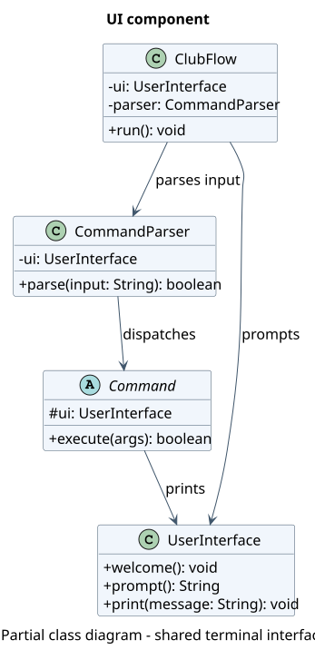
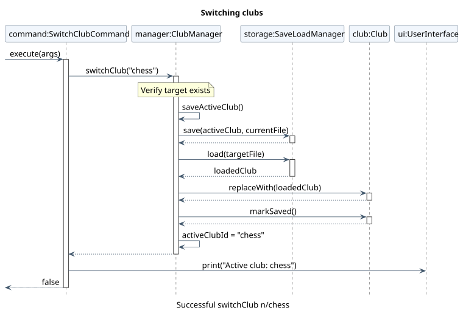

# Camille Maigrot's Project Portfolio Page

### Project: ClubFlow

## Overview

ClubFlow is a Java command-line application for student club managers to organise events, members, event assignments, and photos. It supports multiple independent clubs, each with its own saved data, from a single interface.

## Summary of Contributions

**Code contributed:** [My tP Code Dashboard](https://nus-cs2113-ay2627-s1.github.io/tp-dashboard/?search=camimaigrot) | [Pull requests authored](https://github.com/AY2627S1-CS2113-W10-2/tp/pulls?q=is%3Apr+author%3Acamimaigrot)

### Enhancements implemented

* **New feature: Multiple-club management** ([PR #54](https://github.com/AY2627S1-CS2113-W10-2/tp/pull/54)).
  * **What it does:** Introduced `ClubManager` and four commands, `createClub`, `switchClub`, `listClubs`, and `currentClub`. Each club has separate saved events, members, assignments, and photos. Added validation of club IDs, error handling for duplicate or unknown clubs, migration of legacy single-club saves, and restoration of the last active club on startup.
  * **Justification:** A manager involved in more than one student club can work in one application without mixing their clubs' records.
  * **Technical highlights:** Existing commands retain a reference to one shared `Club` object. Rather than rebuild the parser and every command when switching clubs, `ClubManager` saves the current club, loads the target, and uses `Club.replaceWith(...)` to replace its contents. This required integrating with existing event, member, photo, and save/load workflows and handling failed saves or loads without selecting the wrong club. Added unit and integration tests for isolation, switching, persistence, and recovery.

* **New feature: Date-range event search** ([PR #77](https://github.com/AY2627S1-CS2113-W10-2/tp/pull/77)).
  * **What it does:** Extended `findEvent` with inclusive `from/` and `to/` date filters, allowing searches with a start date, end date, or both, alongside existing criteria.
  * **Justification and highlights:** Managers can locate events in a planning period instead of searching one day at a time. Extended existing search validation to reject malformed dates, reversed ranges, and exact dates outside the selected interval; undated events are excluded from range-filtered results. Added tests for boundaries, combinations of filters, and invalid input.

* **New feature: Upcoming events** ([PR #77](https://github.com/AY2627S1-CS2113-W10-2/tp/pull/77)).
  * **What it does:** Implemented `upcomingEvents` (alias `ue`) to display the active club's pending events scheduled for today or later, ordered by event date and then tag.
  * **Justification and highlights:** Gives club managers an immediate view of what remains to be organised. The command excludes completed, undated, and past events without modifying event data. Added automated tests covering ordering, filtering, aliases, and empty results.

* **Foundational models and testing:** Implemented the initial `Event` and `Member` domain classes with JUnit tests, providing data models later extended by other team members. ([PR #21](https://github.com/AY2627S1-CS2113-W10-2/tp/pull/21), [PR #22](https://github.com/AY2627S1-CS2113-W10-2/tp/pull/22))
* **Terminal UI:** Worked on the welcome-message presentation and terminal UI. ([PR #28](https://github.com/AY2627S1-CS2113-W10-2/tp/pull/28))

### Contributions to the User Guide

* Wrote documentation for **Managing multiple clubs**, including the `createClub`, `switchClub`, `listClubs`, and `currentClub` commands, accepted IDs, error cases, and persistence across launches. ([PR #58](https://github.com/AY2627S1-CS2113-W10-2/tp/pull/58))
* Updated the guide for v2.1, including date-range filtering in **Finding events**, **Viewing upcoming events**, **Clearing an event's details**, and photo import/renaming workflows. These documentation updates cover teammates' features as well. ([PR #79](https://github.com/AY2627S1-CS2113-W10-2/tp/pull/79), [UG](../UserGuide.md))

### Contributions to the Developer Guide

* Documented the **UI component** and **Switching clubs without rebuilding commands**, explaining shared references, save/load sequencing, failure cases, and the design trade-off against recreating commands. Created the [UI class diagram](../diagrams/architecture/UiClassDiagram.puml) and [club-switch sequence diagram](../diagrams/clubs/SwitchClubSequence.puml) and their PlantUML source files. ([PR #58](https://github.com/AY2627S1-CS2113-W10-2/tp/pull/58))
* Revised the DG in response to feedback, simplifying and reorganising the architecture, UI, event-management and photo-import diagrams and their descriptions. The changes include updates to several existing diagrams, not a claim of original authorship for every diagram. ([PR #65](https://github.com/AY2627S1-CS2113-W10-2/tp/pull/65))
* Updated implementation explanations and **Appendix B: User Stories** (including use cases for date searches and upcoming events) and **Appendix E: Instructions for Manual Testing** to reflect v2.1. ([PR #79](https://github.com/AY2627S1-CS2113-W10-2/tp/pull/79), [DG](../DeveloperGuide.md))

### Contributions to team-based tasks

* **Integration:** Adapted club switching to existing commands, storage and photo handling, resolved integration conflicts, and added cross-feature tests rather than treating club management as an isolated command feature. ([PR #54](https://github.com/AY2627S1-CS2113-W10-2/tp/pull/54))

### Review and mentoring contributions

* **Repository administration and PR reviews:** As a team repository administrator, reviewed pull requests according to GitHub's [PRs reviewed by `camimaigrot`](https://github.com/AY2627S1-CS2113-W10-2/tp/pulls?q=is%3Apr+reviewed-by%3Acamimaigrot) filter (checked 3 November 2026). I reviewed changes for coding standards, readability, tests, and integration with existing functionality.
* **Examples of substantive feedback:** Requested improvements to constructor readability and test naming in [PR #46](https://github.com/AY2627S1-CS2113-W10-2/tp/pull/46#pullrequestreview-5610989495); recommended better exception handling and removal of unnecessary authorship markers in [PR #47](https://github.com/AY2627S1-CS2113-W10-2/tp/pull/47#pullrequestreview-5625379580); raised command syntax and branch scope considerations in [PR #50](https://github.com/AY2627S1-CS2113-W10-2/tp/pull/50#pullrequestreview-5642696656); and reviewed additional regression tests in [PR #80](https://github.com/AY2627S1-CS2113-W10-2/tp/pull/80#pullrequestreview-5736650341).

## Contributions to the User Guide (Extracts)

The following commands are from the **Managing multiple clubs** section I documented. See the [full User Guide](../UserGuide.md#managing-multiple-clubs).

* **`createClub n/chess`**: Creates a new empty club named `chess` without changing the active club. The ID `default` is reserved; IDs are case-insensitive and cannot contain spaces or directory separators.
* **`switchClub n/chess`**: Saves the current club and loads `chess`. Subsequent commands affect only that club's events, members, assignments, and photos. An unknown club produces an error without changing the active club.
* **`listClubs`**: Lists valid clubs, identifying the currently selected one.
* **`currentClub`**: Displays the club currently being managed.

## Contributions to the Developer Guide (Extracts)

### UI component

The same `UserInterface` is shared by `ClubFlow`, `CommandParser`, and registered commands. It handles terminal input and output, while application commands operate on club state. Centralised formatting keeps messages consistent, although replacing the terminal with a GUI would require adapting how commands present their results. See the [UI component documentation](../DeveloperGuide.md#ui-component).

*UI component class diagram. [PlantUML source](../diagrams/architecture/UiClassDiagram.puml).*

### Switching clubs without rebuilding commands

ClubFlow supports multiple clubs, while keeping the same parser, command objects, and in-memory `Club` instance. This is important because event and member commands receive their `Club` in their constructors at startup. Replacing the `Club` reference on a switch would leave those commands pointing at the previous club's data.

The implementation first saves the active club, then loads the target into a temporary `Club`, and finally calls `activeClub.replaceWith(loaded)`. Keeping the shared object avoids rebuilding the command registrations. The trade-off is that collaborators should not cache references to individual events or members across club switches. See the [full implementation explanation](../DeveloperGuide.md#switching-clubs-without-rebuilding-commands).

*Switching clubs sequence diagram. [PlantUML source](../diagrams/clubs/SwitchClubSequence.puml).*
